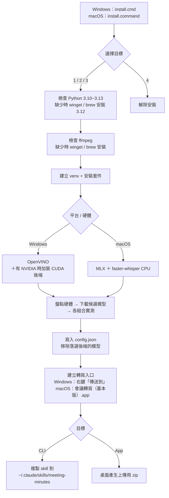
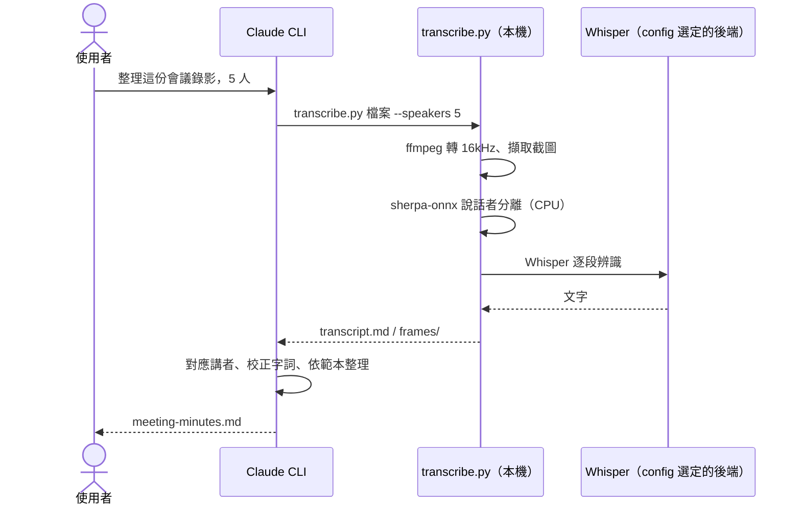
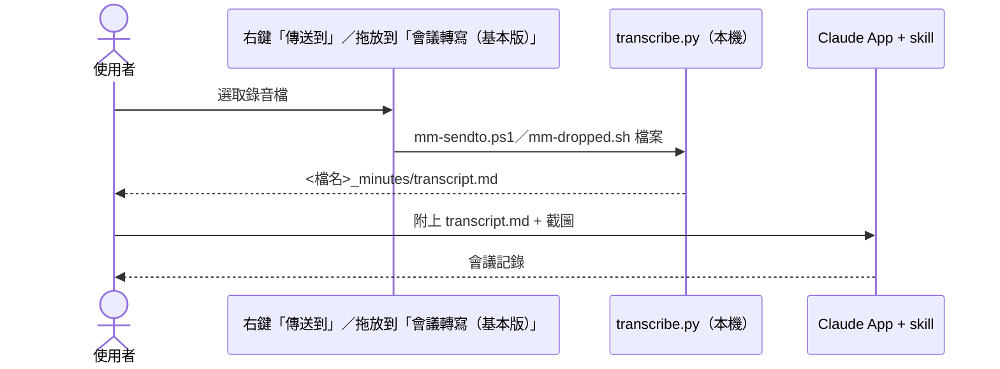
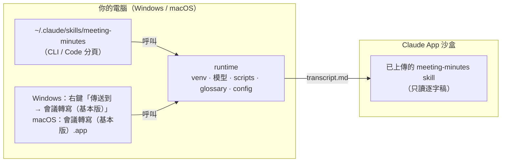

# meeting-minutes：本機轉寫的會議記錄 Skill

> 版本 1.0.1

把會議錄音或錄影在**自己的電腦上**轉成逐字稿，再讓 Claude 整理成繁體中文會議記錄，內容包括摘要、議題、決議、待辦與待釐清問題，每一項都附時間碼。轉寫用的硬體在安裝時自動選定：Intel NPU／GPU、NVIDIA GPU、Apple Silicon GPU 或 CPU。

- 音檔不上傳。Claude 只會讀到逐字稿和影片截圖。
- 支援 **Windows（x64）** 與 **macOS（Apple Silicon）**。
- 同一套安裝可以用在 **Claude CLI**（含 Claude 桌面版的 Code 分頁）和 **Claude 桌面 App**（對話／Cowork）。

這是**基本版**。需要固定錯誤對照表、校正版逐字稿、自動校正、會議摘要、字幕、多種內容類型等功能時，改用進階版 meeting-minutes-pro；兩版可以同時安裝，差異見[與 Pro 版的差異](#與-pro-版的差異)。

**1.0.1 修正**：
- 說明文件、skill 與預設 `glossary.txt` 的範例改用虛構的公司名、人名與通用技術詞（1.0.0 的範例取自實際情境）。預設 `glossary.txt` 只有幾個通用技術詞；安裝程式不會覆蓋已經存在的 `glossary.txt`，升級後你自己加的詞都會保留。
- 右鍵「傳送到 → 會議轉寫（基本版）」與安裝程式讀取 `config.json` 時，找不到檔案或內容壞掉都安靜地略過，不會在主控台印出紅字錯誤（比照 Pro 2.0.1 的修正）。
- 版號寫在四處並保持一致：`scripts/common.py` 的 `VERSION`、`SKILL.md` 的版本註解、`install.ps1`／`install.sh` 的版號變數、本 README 標題下的「版本」。安裝畫面與安裝紀錄會印出版號。
- `huggingface_hub` 加上版本上限 `<3`（與 Pro 版相同），避免日後的大改版讓模型下載失敗。
- 新增 [`THIRD-PARTY-NOTICES.md`](THIRD-PARTY-NOTICES.md)（安裝時也會複製到 runtime 目錄）。
- 安裝程式新增開發測試用的 `-TestRoot`／`--test-root`（見[附錄：開發者測試](#附錄開發者測試)）。功能、輸出檔、`config.json` 都和 1.0.0 相同；從 1.0.0 升級只要重新執行安裝程式。

---

## 目錄

1. [功能](#功能)
2. [系統需求與硬體支援](#系統需求與硬體支援)
3. [一鍵安裝](#一鍵安裝)
4. [使用方式](#使用方式)
5. [架構](#架構)
6. [檔案位置](#檔案位置)
7. [設定與調校](#設定與調校)
8. [準確度與限制](#準確度與限制)
9. [疑難排解](#疑難排解)
10. [解除安裝](#解除安裝)
11. [第三方元件與授權](#第三方元件與授權)
12. [與 Pro 版的差異](#與-pro-版的差異)
13. [附錄：開發者測試](#附錄開發者測試)

---

## 功能

| 功能 | 說明 |
|---|---|
| 本機語音辨識 | Whisper large-v3-turbo，三種推論後端：**OpenVINO**（Intel NPU、Intel GPU、任何 x86-64 CPU）、**faster-whisper**（NVIDIA CUDA；macOS CPU）、**MLX**（Apple Silicon GPU） |
| 安裝時選後端 | 安裝時盤點硬體，所有可用組合都用同一段中文樣本實測，挑最快的寫入 `config.json`。NPU 或 Apple GPU 若在最快者 1.25 倍時間內，會優先選用，以省電並讓出 CPU。**轉寫時不再偵測**，直接照 config 執行 |
| 說話者分離 | sherpa-onnx（pyannote segmentation 3.0 搭配 3D-Speaker 中文聲紋），輸出 S1、S2… 講者標記 |
| 影片截圖 | 偵測畫面變化，自動擷取簡報翻頁和共享畫面，檔名含時間碼 |
| 繁體輸出 | OpenCC `s2twp` 轉換台灣用語。`glossary.txt` 中的專有名詞會保持原樣，並以「台」取代「臺」 |
| 專有名詞提示 | `glossary.txt` 加上單次的 `--hotwords`，提示 Whisper 優先辨識成這些拼法 |
| 幻覺過濾 | 刪除「字幕由…提供」這類 Whisper 常見幻覺句，並壓縮跳針重複的字 |
| 會議記錄 | Claude 依範本整理，並依上下文校正同音錯字。沒聽到的內容不會杜撰，不確定的地方會附時間碼標註 |

## 系統需求與硬體支援

### 系統需求

| 項目 | Windows | macOS |
|---|---|---|
| 作業系統 | Windows 10 22H2 或 Windows 11（x64） | macOS 13.5 以上（建議 14 Sonoma 以上） |
| 處理器 | 任何 x86-64 CPU（Intel 或 AMD） | Apple Silicon（M1 以後） |
| 記憶體 | 16 GB 以上 | 16 GB 以上（統一記憶體） |
| 磁碟 | 約 3 GB；有 NVIDIA 顯卡時，安裝過程最多約 6 GB | 約 4 GB（含 PyTorch） |
| 套件管理 | `winget`（Windows 內建），自動安裝 Python 3.12 與 ffmpeg | [Homebrew](https://brew.sh)（需先自行安裝），自動安裝 Python 3.12 與 ffmpeg |
| 網路 | 安裝時需連線 `pypi.org`、`huggingface.co`、`github.com`；之後轉寫可完全離線 | 同左 |

### 硬體支援

| 硬體 | 後端 | 支援 |
|---|---|---|
| Intel CPU、**AMD CPU**（Windows） | OpenVINO CPU | ✅ 所有 x86-64 電腦的保底選項 |
| Intel 內顯、Arc 顯卡 | OpenVINO GPU | ✅ |
| Intel NPU（Core Ultra） | OpenVINO NPU | ✅ 工作管理員「效能」頁籤要看得到 NPU |
| **NVIDIA GPU**（Pascal 以上、3GB 以上） | faster-whisper CUDA | ✅ 偵測到才安裝；精度依顯卡能力自動選擇（float16 或 int8）；驅動需支援 CUDA 12（R525 以上） |
| **Apple Silicon GPU**（M1～） | MLX | ✅ 透過 Metal 執行 |
| **Apple Silicon CPU** | faster-whisper CPU（int8） | ✅ 與 MLX 一起實測，選較快者 |
| AMD Radeon GPU | — | ❌ 目前沒有對應後端，改用 CPU |
| AMD Ryzen AI NPU | — | ❌ 目前沒有對應後端，改用 CPU |
| Apple Neural Engine（ANE） | — | ❌ 未使用（MLX 跑在 GPU 上） |
| Intel Mac | — | ❌ 安裝程式會直接停止 |
| Snapdragon（Windows ARM64） | — | ❌ 安裝程式會直接停止 |

硬體**只在安裝時偵測一次**。安裝程式會讓所有可用的組合跑同一段中文樣本，挑最快的寫入 `config.json`，並移除落選後端的模型；Windows 上落選的 CUDA 套件也會一併移除，加 `-KeepAll`／`--keep-all` 可保留。之後每次轉寫都直接照 config 執行，不會重新偵測。

## 一鍵安裝

### Windows

1. 把 `meeting-minutes-v1.0.1-installer.zip` **完整解壓縮**到任意資料夾（會解出 `meeting-minutes-v1.0.1` 資料夾）。
2. 雙擊 **`install.cmd`**。
3. 在選單中選擇安裝目標（見下方選單）。
4. 等待安裝完成。第一次安裝約需 5～15 分鐘，大部分時間花在下載模型。

### macOS

1. 先安裝 [Homebrew](https://brew.sh)（已安裝可略過）。
2. 在 Finder 解壓縮 `meeting-minutes-v1.0.1-installer.zip`（會解出 `meeting-minutes-v1.0.1` 資料夾）。
3. 在 **`install.command`** 上**按右鍵 →「打開」**，再按一次「打開」。第一次執行時，macOS 會擋下從網路下載的腳本，用右鍵開啟才能放行。
   - 或者在「終端機」執行：`cd ~/Downloads/meeting-minutes-v1.0.1 && ./install.command`
4. 在選單中選擇安裝目標，等待安裝完成。

### 選單

```
  [1] Claude CLI（含桌面版 Code 分頁）：本機轉寫 + 自動產出會議記錄
  [2] Claude App（對話 / Cowork）：右鍵（Windows）或拖放（macOS）轉寫 + 上傳 skill 整理會議記錄
  [3] 兩者都裝（建議）
  [4] 解除安裝
```

選了 App 的話，安裝程式會把 `meeting-minutes-skill-upload.zip` 放到桌面。請到 Claude App 依序點選「**自訂 (Customize)** →『**Skills**』→『**+**』→『**Create skill**』→『**Upload a skill**』」上傳這個 zip。

- 需要先在「設定 → Capabilities」開啟程式碼執行功能。
- 網頁版的上傳頁面是 <https://claude.ai/customize/skills>。

### 安裝流程



### 命令列參數（進階）

Windows：

```powershell
install.cmd -Target Both                        # 不顯示選單，直接安裝（CLI / App / Both）
install.cmd -Target CLI -Backend openvino:CPU   # 跳過偵測，直接指定（另有 openvino:NPU、openvino:GPU、ct2:cuda）
install.cmd -Target Both -Whisper large-v3      # 改用較準確但較慢的模型
install.cmd -Target Both -KeepAll               # 保留所有後端的模型與套件
install.cmd -Uninstall                          # 解除安裝
```

macOS：

```bash
./install.sh --target both                      # 不顯示選單，直接安裝（cli / app / both）
./install.sh --target cli --backend mlx:gpu     # 跳過偵測，直接指定（另有 ct2:cpu）
./install.sh --target both --whisper large-v3
./install.sh --target both --keep-all
./install.sh --uninstall
```

重新執行安裝程式就是升級：腳本和 skill 會被更新，`glossary.txt` 和已下載的模型則保留。舊版 skill 會備份到 runtime 目錄下的 `backup/`。

## 使用方式

### A. Claude CLI／桌面版 Code 分頁（全自動）

直接跟 Claude 說：

```
用 meeting-minutes 整理 D:\會議\2026-10-12 示範專案週會.mp4，與會 5 人：王小明（專案經理）、李小華（工程師）、張美玲（測試）、林志豪（維運）、陳大文（客戶窗口）
```

macOS 的路徑寫法例如 `~/Documents/會議/0912.m4a`。

Claude 會依序在本機轉寫、讀取逐字稿和截圖、對應講者、校正字詞，最後產出 `meeting-minutes.md`。



### B. Claude 桌面 App（對話／Cowork）

App 的 skill 在沙盒中執行，用不到你電腦的 NPU 或 GPU，所以轉寫這一步要在本機完成：

1. 開始轉寫：
   - **Windows**：在檔案總管對錄音或錄影檔按右鍵 →「**傳送到**」→「**會議轉寫（基本版）**」。Windows 11 若沒看到「傳送到」，先點「顯示其他選項」，或按 Shift 加右鍵。
   - **macOS**：把錄音或錄影檔**拖曳到「應用程式」裡的「會議轉寫（基本版）」**圖示上，或在 Finder 按右鍵 →「打開檔案的應用程式」→「會議轉寫（基本版）」。第一次使用時，macOS 會詢問是否允許它控制「終端機」，請按允許。
2. 輸入與會人數和本次的專有名詞（都可以留空），等它跑完，輸出資料夾會自動打開。
3. 在 Claude App 附上 `transcript.md`（影片可以一併附上 `frames` 裡的截圖），然後說「**用 meeting-minutes 整理成會議記錄**」。



### 輸出檔案

錄音檔旁邊會產生 `<檔名>_minutes/` 資料夾：

| 檔案 | 用途 |
|---|---|
| `transcript.md` | 閱讀用逐字稿，含時間碼、講者和畫面標記。交給 Claude 的就是這個檔案 |
| `transcript.json` | 結構化逐字稿，含 meta 資訊 |
| `transcript.srt` | 字幕檔，可以搭配影片回放 |
| `frames/frame_0003_001523.jpg` | 影片截圖，檔名中的 `001523` 代表 00:15:23 |
| `meeting-minutes.md` | Claude 產出的會議記錄（CLI 模式才會在這裡） |

## 架構



- **runtime**（共用）：Python venv、模型、轉寫腳本。CLI 和本機轉寫入口共用同一份。
- **skill**：只有 `SKILL.md` 和會議記錄範本，CLI 版和 App 版、Windows 版和 macOS 版內容都相同。Skill 會自己判斷所在環境：找得到 runtime 就在本機轉寫，找不到就改讀使用者附上的逐字稿。

## 檔案位置

| 項目 | Windows | macOS |
|---|---|---|
| runtime 根目錄（下稱 `$MMH`） | `%LOCALAPPDATA%\meeting-minutes\` | `~/Library/Application Support/meeting-minutes/` |
| Python | `$MMH\venv\Scripts\python.exe` | `$MMH/venv/bin/python` |
| 模型 | `$MMH\models\` | `$MMH/models/` |
| 腳本 | `$MMH\scripts\`：`transcribe.py`、`setup_backend.py`、`backends.py`、`download_models.py`、`common.py` | 同左 |
| **專有名詞清單（可自行編輯）** | `$MMH\glossary.txt` | `$MMH/glossary.txt` |
| 選定的後端與實測結果 | `$MMH\config.json` | `$MMH/config.json` |
| 安裝紀錄 | `$MMH\install.log` | `$MMH/install.log` |
| Claude CLI skill | `%USERPROFILE%\.claude\skills\meeting-minutes\` | `~/.claude/skills/meeting-minutes/` |
| 轉寫入口 | `%APPDATA%\Microsoft\Windows\SendTo\會議轉寫（基本版）.lnk` | `~/Applications/會議轉寫（基本版）.app` |

想把模型放到其他磁碟，可以設定環境變數 `MEETING_MINUTES_HOME`，然後重新執行安裝程式，讓模型下載到新位置。

## 設定與調校

### 專有名詞（最有效的準確度提升）

編輯 `glossary.txt`，一行一個詞，`#` 開頭為註解：

```
示範證券
Kubernetes
PostgreSQL
DemoCRM
```

上例的公司名與系統名都是虛構的示範用名稱。安裝程式附的預設 `glossary.txt` 只有幾個通用技術詞，請換成你自己會議常出現的詞；重新安裝或升級時不會覆蓋你編輯過的 `glossary.txt`。

單次會議可以另外加 `--hotwords "名詞1, 名詞2"`，本機轉寫入口也會詢問。MLX 後端沒有 hotwords 功能，改用 Whisper 的 initial prompt 提示，所以最多只取前約 200 個字元。

### 手動執行與常用參數

```powershell
# Windows
$MMH = "$env:LOCALAPPDATA\meeting-minutes"
& "$MMH\venv\Scripts\python.exe" "$MMH\scripts\transcribe.py" "D:\會議\0912.m4a" --speakers 4
```

```bash
# macOS
MMH="$HOME/Library/Application Support/meeting-minutes"
"$MMH/venv/bin/python" "$MMH/scripts/transcribe.py" ~/Documents/會議/0912.m4a --speakers 4
```

| 參數 | 說明 |
|---|---|
| `--speakers N` | 與會人數。**強烈建議提供**，分離準確度差很多 |
| `--backend` / `--device` | 手動覆寫 config（僅供測試；正常使用不需要） |
| `--whisper turbo\|large-v3` | 選擇模型（要先用 `download_models.py --backend <後端> --whisper large-v3` 下載） |
| `--hotwords "a, b"` | 本次專有名詞 |
| `--language zh\|en\|auto` | 語言，預設 zh（中英夾雜也用 zh） |
| `--no-diarize` | 不做說話者分離（單人錄音） |
| `--no-keyframes` | 影片不擷取截圖 |
| `--scene 0.3` | 畫面變化門檻，數值越小截圖越多 |
| `--cluster-threshold 0.8` | 不知道人數時的分群門檻，數值越大判斷出的人數越少 |
| `--no-opencc` | 不做簡繁轉換 |

### 重新偵測硬體

轉寫時不會偵測硬體。換顯示卡、更新驅動或 macOS 之後，**重新執行安裝程式**即可。只想重測、不想重裝的話：

```powershell
& "$MMH\venv\Scripts\python.exe" "$MMH\scripts\setup_backend.py"     # Windows
```

```bash
"$MMH/venv/bin/python" "$MMH/scripts/setup_backend.py"               # macOS
```

Windows 上新加裝 NVIDIA 顯示卡時，請執行 `install.cmd`，因為要先安裝 CUDA 後端套件。

`config.json` 範例（macOS）：

```json
{
  "backend": "mlx",
  "device": "gpu",
  "compute_type": "default",
  "whisper": "turbo",
  "detected_at": "2026-10-13T09:12:00",
  "bench": [
    {"backend": "mlx", "device": "gpu", "rtf": 0.05, "ok": true},
    {"backend": "ct2", "device": "cpu", "compute_type": "int8", "rtf": 0.11, "ok": true}
  ]
}
```

## 準確度與限制

| 情境 | 預期表現 |
|---|---|
| 純華語、收音清楚 | 錯誤率大約一成以內，可以直接閱讀 |
| 中英夾雜的技術討論 | Whisper 的弱點，錯誤率明顯上升。靠 glossary 和 Claude 校正補強 |
| 遠距收音、多人搶話 | 錯誤率上升，講者分離也容易混淆 |
| 台語 | 不支援，辨識結果不可靠 |

另外要注意以下幾點：

- 逐字稿是 ASR 原始結果，只經過繁體轉換和幻覺過濾，**沒有經過人工校正**。Claude 的校正寫在會議記錄裡，逐字稿本身維持原樣，方便回頭查證。
- S1、S2 只是聲紋分群的結果，對應到姓名要靠 Claude 從對話內容推斷，或由你提供與會名單。
- 最快的裝置不一定是直覺上的那個。例如 Arrow Lake 桌機版的 NPU 算力有限，多核心 CPU 可能更快；舊款 NVIDIA 顯卡（例如 GTX 1050 Ti）也不一定快過新 CPU。這些都由安裝時的實測決定。
- 不同後端使用的模型格式不同（OpenVINO INT8、CTranslate2、MLX），辨識結果可能有細微差異。

## 疑難排解

| 狀況 | 處理 |
|---|---|
| 候選組合裡沒有 NPU | 確認工作管理員看得到 NPU，更新 Intel NPU 驅動後重新執行 `install.cmd` |
| 候選組合裡沒有 NVIDIA | 確認 `nvidia-smi` 可執行、驅動支援 CUDA 12，且顯示記憶體至少 3GB |
| 候選組合裡沒有 MLX（macOS） | 確認是 Apple Silicon Mac，且 Python 是 arm64 原生版（不是 Rosetta）。重新執行 `install.command` |
| 轉寫時顯示「無法以 … 載入 Whisper」 | 硬體、驅動或系統已變更，重新執行安裝程式重新偵測 |
| 想強制用某個裝置 | Windows：`install.cmd -Backend openvino:CPU`；macOS：`./install.sh --backend ct2:cpu` |
| macOS 顯示「無法打開，因為它來自未識別的開發者」 | 對 `install.command` 按右鍵 →「打開」；或到「系統設定 → 隱私權與安全性」按「強制打開」 |
| macOS 拖放後沒有反應 | 到「系統設定 → 隱私權與安全性 → 自動化」，允許「會議轉寫（基本版）」控制「終端機」 |
| 找不到 Homebrew（macOS） | 依 <https://brew.sh> 的指示安裝後，開新的終端機再執行 `install.command` |
| 講者人數不對 | 加上 `--speakers N` |
| 專有名詞一直錯 | 加到 `glossary.txt` |
| 輸出是簡體字 | 確認沒有加 `--no-opencc` |
| 找不到 ffmpeg | 開新的終端機（Windows 可能需要登出再登入）讓 PATH 生效，然後重新執行安裝程式 |
| Windows 右鍵沒有「會議轉寫（基本版）」 | Windows 11 要先點「顯示其他選項」，或重新執行 `install.cmd` |
| App 上傳 skill 失敗 | 確認上傳的是桌面上的 `meeting-minutes-skill-upload.zip`（不要自行重新壓縮），並確認已開啟程式碼執行功能 |
| CLI 出現兩個 meeting-minutes | CLI 以 claude.ai 帳號登入時，App 上傳的 skill 會同步過來。兩者內容相同，可以留一個 |
| pip 安裝失敗 | 查看 `install.log`。公司網路若有 proxy，先設定 `HTTPS_PROXY` 再重新安裝 |

## 解除安裝

- **Windows**：雙擊 `uninstall.cmd`，或執行 `install.cmd -Uninstall`。
- **macOS**：在 `uninstall.command` 上按右鍵 →「打開」，或執行 `./install.sh --uninstall`。

會移除以下項目：

- Claude CLI skill
- 轉寫入口（Windows 的右鍵捷徑、macOS 的 `會議轉寫（基本版）.app`）
- 桌面上的上傳用 zip
- runtime 與模型（會先詢問；選擇保留的話，`glossary.txt` 也會留著）

上傳到 Claude App 的 skill 不會被自動移除，請到「自訂 → Skills」手動刪除。透過 winget 或 Homebrew 安裝的 Python 與 ffmpeg 也會保留。

## 第三方元件與授權

| 元件 | 用途 | 授權 |
|---|---|---|
| [OpenVINO / OpenVINO GenAI](https://github.com/openvinotoolkit/openvino.genai) | 推論引擎（Windows：Intel／CPU） | Apache-2.0 |
| [faster-whisper](https://github.com/SYSTRAN/faster-whisper) / CTranslate2 | 推論引擎（Windows：NVIDIA；macOS：CPU） | MIT |
| NVIDIA cuBLAS / cuDNN（pip 套件） | CUDA 函式庫（僅 Windows 且有 NVIDIA 顯卡時安裝） | NVIDIA 授權 |
| [MLX](https://github.com/ml-explore/mlx) / [mlx-whisper](https://github.com/ml-explore/mlx-examples/tree/main/whisper) | 推論引擎（macOS：Apple GPU） | MIT |
| Whisper large-v3-turbo（[OpenVINO INT8](https://huggingface.co/OpenVINO/whisper-large-v3-turbo-int8-ov)、[CTranslate2](https://huggingface.co/mobiuslabsgmbh/faster-whisper-large-v3-turbo)、[MLX](https://huggingface.co/mlx-community/whisper-large-v3-turbo)） | 語音辨識 | MIT |
| [sherpa-onnx](https://github.com/k2-fsa/sherpa-onnx) | 說話者分離 | Apache-2.0 |
| pyannote segmentation 3.0 | 語音分段 | MIT |
| 3D-Speaker ERes2Net | 中文聲紋 | Apache-2.0 |
| [OpenCC](https://github.com/BYVoid/OpenCC)（python 實作） | 簡繁轉換 | Apache-2.0 |
| [FFmpeg](https://ffmpeg.org/) | 音訊與影片處理（由 winget 或 Homebrew 另行安裝） | LGPL／GPL |

模型在安裝時才從官方來源下載，安裝包本身不含任何模型。各元件的來源與授權見 [`THIRD-PARTY-NOTICES.md`](THIRD-PARTY-NOTICES.md)（安裝時也會複製到 `$MMH`）。

## 與 Pro 版的差異

| 功能 | 基本版 meeting-minutes | Pro 版 meeting-minutes-pro |
|---|---|---|
| 本機轉寫（Whisper large-v3-turbo，安裝時選硬體） | ✅ | ✅ |
| 說話者分離（sherpa-onnx，CPU） | ✅ | ✅（另可選裝 NVIDIA GPU 說話者分離） |
| 影片截圖、繁體輸出、`glossary.txt`、幻覺過濾 | ✅ | ✅ |
| 字幕 | `transcript.srt` | 另有 `transcript.cues.srt`（依字幕規則切條）、`transcript.corrected.srt`（校正後） |
| 固定錯誤對照表（`corrections.tsv`，轉寫後自動替換） | — | ✅ |
| 校正版逐字稿（`transcript.corrected.md`，標出每一處修改） | — | ✅ |
| Breeze-ASR-25（中英夾雜很重的技術會議） | — | ✅（選裝） |
| 本機分段標點、OpenCC 詞彙回復表 | — | ✅ |
| 自動校正、會議摘要（runtime 直接呼叫 Claude 或 OpenAI） | — | ✅（選用） |
| 內容類型（會議、課程、訪談等 7 種）與自訂範本 | 只有會議 | ✅ |
| 執行 log（各步驟耗時、token、費用） | — | ✅ |
| 會議記錄 | Claude 依範本整理 | 同左，另可由 runtime 自動產生 |

兩版**可以同時安裝**，互不影響：

| 項目 | 基本版 | Pro 版 |
|---|---|---|
| Skill 名稱 | `meeting-minutes` | `meeting-minutes-pro` |
| runtime（Windows） | `%LOCALAPPDATA%\meeting-minutes` | `%LOCALAPPDATA%\meeting-minutes-pro` |
| runtime（macOS） | `~/Library/Application Support/meeting-minutes` | `~/Library/Application Support/meeting-minutes-pro` |
| 轉寫入口（傳送到／應用程式） | 會議轉寫（基本版） | 會議轉寫（Pro） |
| 環境變數 | `MEETING_MINUTES_HOME` | `MEETING_MINUTES_PRO_HOME` |

- 兩版的 `glossary.txt` **各自獨立**，改一邊不會影響另一邊。要沿用基本版的詞，把檔案複製到 Pro 版的 runtime 目錄即可。
- 兩版各有一份模型，同時安裝時多佔約 2～4 GB。
- 兩版都裝時，在 Claude 裡用名稱指定比較明確，例如「用 meeting-minutes 整理…」或「用 meeting-minutes-pro 整理…」。
- 兩版的輸出資料夾都是 `<檔名>_minutes/`。對同一個檔案先後用兩版轉寫，後跑的會覆蓋 `transcript.*`。

## 附錄：開發者測試

| 參數／環境變數 | 作用 |
|---|---|
| `install.cmd -TestRoot <資料夾>`、`./install.sh --test-root <資料夾>` | 1.0.1 起，僅供測試：runtime 改裝到 `<資料夾>/home`（模型與 `config.json` 也寫在這裡），skill、右鍵捷徑（Windows）或 `.app`（macOS）、桌面上傳檔都改放到 `<資料夾>` 底下，也不會開啟檔案總管或 Finder；可以和 `-Uninstall`／`--uninstall` 一起用。winget／Homebrew 安裝的 Python 與 ffmpeg 仍是系統共用的 |
| `MM_TEST_NO_OPEN=1` | 1.0.1 起：轉寫入口完成後不開啟輸出資料夾 |

1.0.1 的 Windows 安裝實測在 `-TestRoot` 底下進行，不碰使用者真正的安裝位置。macOS 的 `--test-root` 只做過語法檢查，沒有實機驗證。
