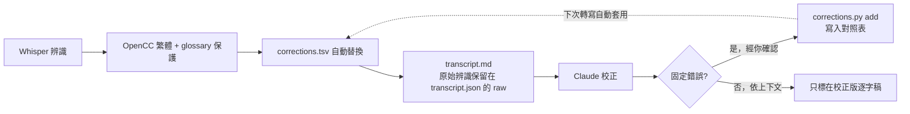
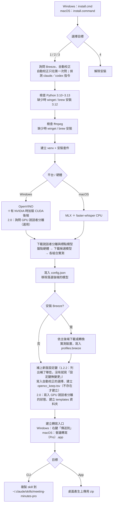
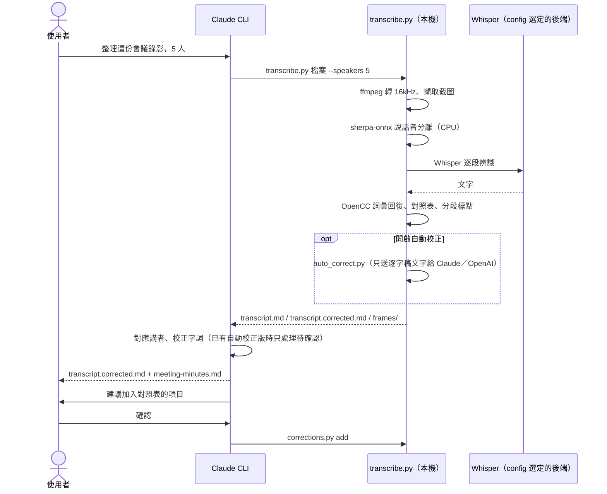
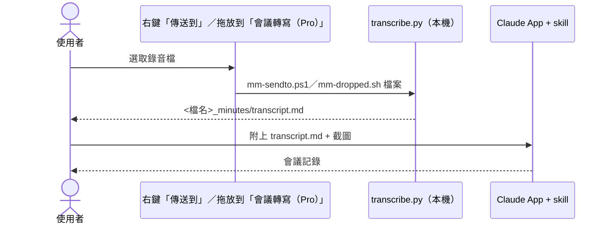
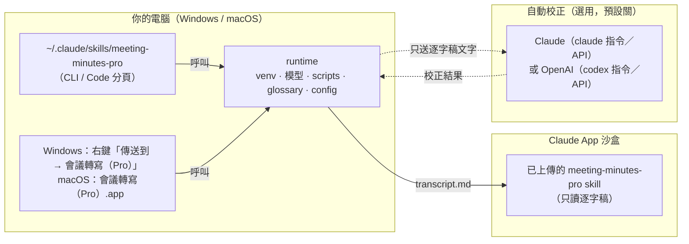

# meeting-minutes-pro：本機轉寫的會議記錄 Skill（進階版）

> 版本 2.0.2

把會議錄音或錄影在**自己的電腦上**轉成逐字稿，再讓 Claude 整理成繁體中文會議記錄，內容包括摘要、議題、決議、待辦與待釐清問題，每一項都附時間碼。2.0 起也能整理課程、訪談節目、操作教學、座談、工作坊、需求訪談的錄音（共 7 種內容類型，另可自訂範本），並產生校正版字幕；有 NVIDIA 顯示卡時可以選裝 GPU 說話者分離。轉寫用的硬體在安裝時自動選定：Intel NPU／GPU、NVIDIA GPU、Apple Silicon GPU 或 CPU。

- 音檔不上傳。Claude 只會讀到逐字稿和影片截圖。做選用的[自動校正](#6-自動校正選用)或[會議摘要](#7-會議摘要選用120)時，逐字稿文字會送到你選的供應商（Anthropic 或 OpenAI）。
- 支援 **Windows（x64）** 與 **macOS（Apple Silicon）**。
- 同一套安裝可以用在 **Claude CLI**（含 Claude 桌面版的 Code 分頁）和 **Claude 桌面 App**（對話／Cowork）。

Pro 版在基本版 `meeting-minutes` 之外，多了十二項功能：

1. **固定錯誤對照表**（`corrections.tsv`）：固定的誤辨識（例如「Kubernetes」總是被辨識成「酷伯內蒂斯」）累積成表，轉寫後自動替換，越用越準。
2. **校正版逐字稿**（`transcript.corrected.md`）：Claude 標出每一處修改，方便回頭查證。
3. **Breeze-ASR-25**：中英夾雜很重的技術會議改用這個模型，比 turbo 準。
4. **本機分段標點**（1.1.0）：轉寫時就在本機依講者、停頓與段長分段，並補上標點。
5. **OpenCC 詞彙回復表**（1.1.0）：不讓簡繁轉換把「權限」「分區」「帳號」改成「許可權」「分割槽」「賬號」。
6. **自動校正**（1.1.0，選用）：轉寫完成後自動呼叫 Claude 或 OpenAI 校正同音錯字與專有名詞，產出校正版逐字稿與對照表建議。
7. **會議摘要**（1.2.0，選用）：runtime 直接呼叫 Claude 或 OpenAI 整理出 `meeting-minutes.md`（摘要、議題、決議、待辦、待釐清問題，附時間碼）；長會議分段整理再彙整。
8. **執行 log**（1.2.0）：每次轉寫記下各步驟的時間、每次模型呼叫的 token 與 API 等價費用，`runlog.py summary` 可以彙整成表。
9. **內容類型**（2.0）：會議、課程、訪談節目、操作教學、座談、工作坊、需求訪談 7 種，各自整理成適合的筆記（非會議類型是 `notes.md`）。
10. **自訂範本**（2.0）：在 `templates` 資料夾放自己的範本，延伸內建類型（例「週會（研發處）」）。
11. **字幕**（2.0）：`transcript.cues.srt`（依字幕規則重新切條）與 `transcript.corrected.srt`（AI 校正後的字幕）。
12. **說話者分離改進**（2.0）：填人數時保留發言最多的 N 位、發言很少的代號標 ⚠；NVIDIA 顯示卡可選裝 GPU 說話者分離（pyannote）。

**2.0.0 的改進**（從 1.x 升級前請先看[升級注意（1.x → 2.0）](#升級注意1x--20)）：
- 轉寫前多一題「內容類型」（第一題；直接按 Enter＝會議，之後會記住上次的選擇），講者人數那一題可以輸入 `s` 略過說話者分離（[入口流程](#入口流程120)）。
- 7 種內容類型與自訂範本（[內容類型](#9-內容類型20)、[自訂範本](#10-自訂範本20)）；字幕兩個新檔（[字幕](#11-字幕20)）；講者人數的新意義、零星講者標示、分群門檻依類型、GPU 說話者分離（[說話者分離與講者人數](#12-說話者分離與講者人數20)、[啟用 GPU 說話者分離](#啟用-gpu-說話者分離選用)）。

**2.0.1 修正**：
- 升級或新安裝後**第一次**用右鍵「傳送到 → 會議轉寫（Pro）」時，「內容類型」選單前不會再出現一段紅字錯誤（「Get-Content : 找不到 …\state.json 路徑…」）。2.0.0 那段紅字只是因為還沒有記住上次選擇的檔案（`state.json`），不影響轉寫結果；2.0.1 改成找不到或內容壞掉時都安靜地當作「沒有上次的選擇」（Enter＝會議）。
- 同一類寫法一併修正：Windows 全新安裝時（還沒有 `config.json`）安裝程式也不會再印同樣的紅字。功能、設定鍵、輸出檔都和 2.0.0 相同；從 2.0.0 升級只要重新執行安裝程式。

**2.0.2 修正**：
- 說明文件、skill 的範例與預設詞表改用虛構名稱：範例裡的公司、人名、系統名與會議情境都換成示範用的名字（例「星河物流」「王小明」），固定錯誤對照表的範例改成「酷伯內蒂斯 → Kubernetes」，預設 `glossary.txt` 只留說明與幾個通用技術詞。安裝程式**不會覆蓋**你已經有的 `glossary.txt`、`corrections.tsv`，所以升級後你自己的詞表照舊。
- 程式註解與說明文件拿掉內部的開發紀錄編號，改寫成功能開始的版號（例〔1.2.2〕）。
- 程式行為、設定鍵、輸出檔都和 2.0.1 相同；從 2.0.1 升級只要重新執行安裝程式。

1.2.0 起，右鍵「傳送到」與 macOS 拖放入口在**逐字稿完成後**依序問「要做 AI 校正嗎？」「要產生會議摘要嗎？」，兩題直接按 Enter 都是「是」（見[入口流程（1.2.0）](#入口流程120)）。

1.2.1 的改進：
- 長會議分段整理時，每段附上前後段的幾句話當上下文，段落交界被切開的討論不會再被列成「待釐清問題」（[會議摘要](#7-會議摘要選用120)）。
- 會議摘要的選模型選單把 Claude `sonnet` 標成「較快」（AI 校正的選單仍標「準確率較低」）。
- 會議記錄的待辦表多一欄「時間碼」，不再寫在備註欄。
- 用 `-Backend`（macOS `--backend`）重新安裝時，後端與裝置和原本相同就沿用原本的精度（例 `int8_float16`）；另可用 `-ComputeType`（`--compute-type`）指定。

1.2.2 的改進：
- 右鍵「傳送到」與 macOS 拖放入口每次詢問前，先清掉處理中誤按的按鍵：轉寫或 AI 處理時不小心按到 Enter，不會再讓下一題被誤答，或在結束時讓視窗直接關閉（[入口流程](#入口流程120)）。
- 會議摘要的「待釐清問題」更嚴格：會中已經有答覆（包括「看完某個結果再決定」這種有條件的答覆）、只是在說明現況、會中沒有人問的事，都不列（[會議摘要](#7-會議摘要選用120)）。
- 畫面與檔案上的分段數一律寫「段」（例「第 3/17 段 OK」「剩下 3 段未校正」「6/6 段完成」），不再寫「塊」，避免「17 塊」被看成金額。README 中 1.2.1 以前的實測紀錄仍寫「塊」，意思相同。
- 安裝畫面：升級時「硬體偵測」那一步不再印「版號不一致：請重新執行安裝程式」（改印「升級中：1.2.1 → 1.2.2…」）；「更新設定」那一步依實際情況寫「已補上新版設定鍵：…」或「設定鍵無變更」。

Pro 版有自己的 skill 名稱、runtime 目錄和轉寫入口，**可以和基本版同時安裝**，互不影響（詳見[與基本版並存](#與基本版並存)）。

---

## 目錄

1. [功能](#功能)
2. [Pro 版功能說明](#pro-版功能說明)
3. [升級注意（1.x → 2.0）](#升級注意1x--20)
4. [系統需求與硬體支援](#系統需求與硬體支援)
5. [一鍵安裝](#一鍵安裝)（含[啟用 GPU 說話者分離](#啟用-gpu-說話者分離選用)）
6. [使用方式](#使用方式)
7. [架構](#架構)
8. [檔案位置](#檔案位置)
9. [設定與調校](#設定與調校)
10. [準確度與限制](#準確度與限制)
11. [疑難排解](#疑難排解)
12. [解除安裝](#解除安裝)
13. [第三方元件與授權](#第三方元件與授權)
14. [與基本版並存](#與基本版並存)
15. [附錄：macOS 實測狀態與開發者測試](#附錄macos-實測狀態與開發者測試)

---

## 功能

| 功能 | 說明 |
|---|---|
| 本機語音辨識 | Whisper large-v3-turbo，三種推論後端：**OpenVINO**（Intel NPU、Intel GPU、任何 x86-64 CPU）、**faster-whisper**（NVIDIA CUDA；macOS CPU）、**MLX**（Apple Silicon GPU） |
| 安裝時選後端 | 安裝時盤點硬體，所有可用組合都用同一段中文樣本實測，挑最快的寫入 `config.json`。NPU 或 Apple GPU 若在最快者 1.25 倍時間內，會優先選用，以省電並讓出 CPU。**轉寫時不再偵測**，直接照 config 執行 |
| 說話者分離 | sherpa-onnx（pyannote segmentation 3.0 搭配 3D-Speaker 中文聲紋，CPU），輸出 S1、S2… 講者標記；2.0 起有 NVIDIA 顯示卡可選裝 GPU 版（pyannote community-1） |
| 影片截圖 | 偵測畫面變化，自動擷取簡報翻頁和共享畫面，檔名含時間碼 |
| 繁體輸出 | OpenCC `s2twp` 轉換台灣用語。`glossary.txt` 中的專有名詞會保持原樣，並以「台」取代「臺」 |
| 專有名詞提示 | `glossary.txt` 加上單次的 `--hotwords`，提示 Whisper 優先辨識成這些拼法 |
| 幻覺過濾 | 刪除「字幕由…提供」這類 Whisper 常見幻覺句，並壓縮跳針重複的字 |
| 會議記錄 | Claude 依範本整理，並依上下文校正同音錯字。沒聽到的內容不會杜撰，不確定的地方會附時間碼標註 |
| **錯誤對照表**（Pro） | `corrections.tsv` 在轉寫後自動替換固定錯誤；正確寫法也會自動加入辨識提示 |
| **校正版逐字稿**（Pro） | `transcript.corrected.md`，以 `{原文→修正}` 標示每處修改，`[?…]` 標示待確認 |
| **Breeze-ASR-25**（Pro，選裝） | 台灣華語與中英夾雜特化模型，三種後端都支援 |
| **本機分段標點**（Pro 1.1.0） | 依講者切換、停頓（預設 2 秒）、段長（預設 200 字）分段；Breeze 一律用 CT-Transformer 補標點，turbo 標點夠密就沿用 Whisper 的。全在本機、不送雲端 |
| **OpenCC 詞彙回復表**（Pro 1.1.0） | `s2twp` 轉換前先保護台灣也在用的詞（權限、分區、窗口、發布、帳號……），可在 `opencc_keep.tsv` 自行加詞 |
| **自動校正**（Pro 1.1.0，選用） | 轉寫後由 Claude（`claude` 指令）或 OpenAI（`codex` 指令）自動校正，產出 `transcript.corrected.md` 與 `corrections.suggested.tsv`；入口每次轉寫完會問（1.2.0），CLI 對話中依安裝時的設定 |
| **會議摘要**（Pro 1.2.0，選用） | 轉寫後由 Claude 或 OpenAI 整理成 `meeting-minutes.md`，有校正版就用校正版；入口每次轉寫完會問 |
| **執行 log**（Pro 1.2.0） | `run_log.jsonl`（每個輸出資料夾）與 `logs/runs.jsonl`（每次一列）；記檢查點時間、token、API 等價費用，不記逐字稿文字與金鑰 |
| **內容類型**（Pro 2.0） | 會議、課程、訪談節目、操作教學、座談、工作坊、需求訪談；非會議類型產出 `notes.md`＋`notes.json` |
| **自訂範本**（Pro 2.0） | `$MMH/templates/*.md`：改名稱、講者預設、節標題，補一段整理重點；不能改模型、指令或送出的檔案 |
| **字幕**（Pro 2.0） | `transcript.cues.srt`（不經 AI，依 Netflix 繁中字幕規則切條）、`transcript.corrected.srt`（校正版） |
| **GPU 說話者分離**（Pro 2.0，選用） | NVIDIA 顯示卡＋pyannote：每小時錄音約 1.5 分鐘；權重要自己到 Hugging Face 同意條件後下載 |

## Pro 版功能說明

### 1. 固定錯誤對照表（corrections.tsv）



- 格式：一行一筆，用 Tab 分隔「錯誤寫法、正確寫法、備註」，`#` 開頭為註解。
- 替換方式：長的詞優先，整份逐字稿只掃描一次，所以不會發生「A 改成 B 之後，B 又被改成 C」的連鎖替換。
- 正確寫法會自動併入 Whisper 的提示詞，讓模型下次直接辨識正確。
- **預設不會自動寫入對照表**：每次校正後，Claude（或自動校正產生的 `corrections.suggested.tsv`）會列出建議加入的項目，你確認之後才寫入。App 模式下 Claude 寫不到你的電腦，會給你一段可以直接貼上的 TSV。想讓符合嚴格條件的建議自動寫入，見[對照表條件式自動寫入](#對照表條件式自動寫入選用預設關)。
- 防呆：單一字元、和既有項目衝突、錯誤寫法與正確寫法相同的項目，工具都會拒絕寫入。
- 適合放：專有名詞固定的錯法（「酷伯內蒂斯」改「Kubernetes」、「星荷物流」改「星河物流」）。
  不適合放：要看上下文才能判斷的同音字（「權限」和「全線」），這類每次交給 Claude 校正。

維護指令：

```bash
python corrections.py list                                  # 列出全部
python corrections.py add "酷伯內蒂斯" "Kubernetes" --note "示範專案週會"  # 新增
python corrections.py remove "酷伯內蒂斯"                              # 移除
python corrections.py test "我們的酷伯內蒂斯叢集"                       # 試套用，不寫檔
```

（`python` 要用 runtime venv 裡的 Python，路徑見[檔案位置](#檔案位置)。）

### 2. 校正版逐字稿（transcript.corrected.md）

`transcript.md` 永遠保持原樣，Claude 另外輸出一份校正版：

```markdown
**[00:00:00] 王小明（S1）**：今天討論 {星荷→星河}物流的倉儲系統升級，[?七月三號｜七月十三號] 上線……
```

| 標記 | 意義 |
|---|---|
| `{原文→修正}` | Claude 修改的地方 |
| `{原文→}` | 刪除（幻覺句、跳針重複） |
| `[?原文｜推測]` | 不確定，建議回聽 |
| `姓名（S#）` | 講者對應 |

檔案開頭附「校正摘要」（原文、修正、次數、依據、是否建議加入對照表）、「講者對應」和「待確認」清單。會議記錄以校正版為準撰寫。完整格式見 skill 內的 `references/corrected-transcript-format.md`。

### 3. Breeze-ASR-25（選裝）

[Breeze-ASR-25](https://huggingface.co/MediaTek-Research/Breeze-ASR-25) 是 MediaTek Research 以 Whisper large-v2 微調的台灣華語模型（Apache-2.0）。在中英夾雜的評測資料上，錯誤率大約是 Whisper large-v3 的一半，但速度比 turbo 慢好幾倍。

| 主後端（安裝時選定） | Breeze 的取得方式 | 額外空間 |
|---|---|---|
| OpenVINO（Intel NPU／GPU／CPU） | **安裝時轉換**：建立暫時環境（optimum-intel 加 PyTorch），下載原始模型並轉成 INT8，轉完刪除暫時環境 | 約 1.6 GB（轉換過程暫用約 5 GB），多花 10～20 分鐘 |
| faster-whisper（NVIDIA CUDA／Mac CPU） | 下載現成的 CTranslate2 版，依精度只下載需要的子資料夾 | 約 1.6～3 GB |
| MLX（Apple GPU） | 下載現成的 MLX fp16 版 | 約 3 GB |

- Breeze 一律跟著主後端走，安裝時會在主裝置上實測。例如 NPU 載入失敗，就改用 CPU，並把結果寫進 `config.json` 的 `profiles.breeze`。**轉寫時不再偵測**。
- 選用方式：轉寫時加 `--whisper breeze`。本機轉寫入口會詢問是否使用；CLI 模式下，Claude 會依你描述的會議類型判斷，判斷不了會先問你，並附上預估時間。
- 事後加裝：`setup_backend.py --breeze-only`。

### 4. 本機分段標點

1.0.0 的 `transcript.md` 是同一位講者連續說的話全部併成一段，而且 turbo 常常沒有標點、Breeze 幾乎沒有標點。1.1.0 在轉寫時就在本機把段落切好、標點補上：

- **分段**：講者切換、與上一句的停頓 ≥ 2 秒（`punctuation.paragraph_gap`）、段落累積到 200 字（`punctuation.paragraph_max_chars`）、影片畫面切換，任何一個成立就換段。
- **標點**：Breeze 一律交給 CT-Transformer 標點模型；turbo 等模型標點夠密（每 20 個字至少 1 個標點）就沿用 Whisper 自帶的，不夠才交給 CT-Transformer。
- **模型**：CT-Transformer 中文標點模型（sherpa-onnx 轉換的 int8 版，約 65 MB），安裝時下載、驗證 SHA-256，**不包含在安裝包內**。下載失敗不會中止安裝：逐字稿仍會分段，turbo 沿用 Whisper 標點，之後可執行 `setup_backend.py --punct-only` 補裝（離線時可用 `--punct-archive <本機 tar.bz2>`）。授權見 [`THIRD-PARTY-NOTICES.md`](THIRD-PARTY-NOTICES.md)。
- **速度**：一小時錄音的分段標點在數秒內完成，不送雲端。
- `transcript.md` 開頭會多一行「分段標點：本機（CT-Transformer N 段、Whisper 標點 N 段；停頓 ≥ 2.0 s 或滿 200 字換段）」。加標點前的文字保留在 `transcript.json` 的 `segments[].text_plain`。
- 要回到 1.0.0 的段落與文字：轉寫時加 `--no-punct --no-opencc-keep`。

### 5. OpenCC 詞彙回復表

OpenCC 的 `s2twp`（簡體轉台灣正體加台灣用語）會把一些台灣本來就在用的詞換掉，例如「權限」變「許可權」、「分區」變「分割槽」、「帳號」變「賬號」、「審核通過」變「審核透過」。1.1.0 在轉換前先把這些詞保護起來，轉完再放回：

- 內建表隨腳本更新（`scripts/opencc_keep_default.tsv`）；你自己的詞加在 `$MMH/opencc_keep.tsv`（安裝時建立，重新安裝不會覆蓋）。
- 格式：一行一筆，用 Tab 分隔「保留寫法、其他來源寫法（逗號分隔，可留空）、備註」；以 `-` 開頭的行（例：`-數據`）停用內建表的同名項目。
- 先試再加：`python opencc_keep.py test "要測試的句子"` 會顯示轉換前後與命中的詞。
- `transcript.md` 開頭會列出本次回復了哪些詞，例如「OpenCC 詞彙回復：權限 ×3、分區 ×2」。
- 本次不套用：轉寫時加 `--no-opencc-keep`。
- 「登錄」已移出內建表（1.1.0）：Whisper 常把講者說的「登入」寫成「登录」，保留「登錄」反而會把它保護成錯字，所以現在「登录」一律轉成「登入」。你的會議常說「登錄」（＝登記）而且要保留時，在 `opencc_keep.tsv` 加一行 `登錄`。
- 和 `corrections.tsv` 的分工：OpenCC 改錯的詞放這裡；Whisper 本身聽錯的固定錯誤（「酷伯內蒂斯」→「Kubernetes」）才放對照表。

### 6. 自動校正（選用）

轉寫完成後，由本機的 runtime 直接呼叫 Claude 或 OpenAI，校正同音錯字與專有名詞，產出 `transcript.corrected.md`（標記格式與對話中校正相同）、`corrections.suggested.tsv`（對照表建議，尚未生效）與 `auto_correct.json`（執行紀錄，不含逐字稿內容與金鑰）。`transcript.md` 一個字都不會改。之後在對話中，Claude 只需要處理待確認 `[?…]`、講者對應、會議記錄與對照表確認，不必重做全文校正。

**開關**

- **右鍵「傳送到」與 macOS 拖放入口（1.2.0）**：每次逐字稿完成後都會問「要做 AI 校正嗎？[Y/n]」，直接按 Enter 就是「是」，再選這次用哪個模型（見下方〈入口選模型〉）。不想每次都按 Enter，把 `config.json` 的 `correction.ask_default` 改成 `false`（Enter 變成「否」）。
- **Claude CLI 對話與命令列**：照 `config.json` 的 `correction.enabled`（預設關；安裝程式第一次安裝或從 1.0.0 升級時問一次，之後要改就重新執行安裝程式加 `-Correct`／`-NoCorrect`，macOS：`--correct`／`--no-correct`）。1.2.0 起這個值**只管 CLI 對話與命令列**，入口不看它，所以 1.1.0 回答 N 的人升級後在入口也會看到詢問。
- 單次覆寫：轉寫時加 `--correct`／`--no-correct`；`--claude`、`--openai` 是「這次用這一家自動校正」的捷徑。
- 錄音超過 120 分鐘（`correction.confirm_over_minutes`）時，入口在詢問前多印一行，寫明這次預估的時間與費用。
- 自動校正失敗（未登入、額度用完、網路、逾時）**不影響轉寫**：轉寫照常完成，之後照 1.0.0 的方式在對話中校正，或修好後執行 `auto_correct.py "<檔名>_minutes"` 補做。

**兩家供應商**

| 供應商 | 訂閱通道（預設，已實測） | API 通道（選用，**未實測**） |
|---|---|---|
| Claude（Anthropic） | Claude Code 的 `claude` 指令，用你的 Claude 訂閱額度 | Anthropic Python SDK，環境變數 `ANTHROPIC_API_KEY`，依用量付費 |
| OpenAI | Codex 的 `codex` 指令（`codex exec`，唯讀、不執行任何工具），用你的 ChatGPT 訂閱的 Codex 額度 | OpenAI Python SDK，環境變數 `OPENAI_API_KEY`，依用量付費 |

- `correction.provider` 預設 `auto`：**找得到 `codex` 指令而且已登入時用 OpenAI `gpt-6.1-sol`**；否則找得到 `claude` 指令就用 Claude `opus`（`codex` 有裝但沒登入時也退回 Claude，並在執行時寫明原因）；兩個都沒有就略過。1.1.0 依實測這樣選：同一份素材、同一個 prompt，`gpt-6.1-sol` `low` 修對 M1 約 89～90%、M3 約 81%，錯改 0～1.5%，比 Claude `opus` `medium`（M1 87%、M3 78～80%、錯改 1.6～2.8%）略好，API 等價費用約 1/2～1/3（見下方〈模型與推理強度：實測與推薦〉）。安裝程式問你的時候會先偵測兩個指令（只執行 `claude --version`、`codex --version`、`codex login status`，不呼叫模型、不耗額度），並寫明會用哪一家；你回答 y 之後，設定會記下**那一家**，之後新裝了另一家的指令也不會自動改送過去。
- 兩個都沒有時，安裝程式會問要不要改用 API 金鑰，並依你選的供應商安裝 `anthropic` 或 `openai` 套件。金鑰**只從環境變數讀**，不寫進 `config.json`、log 或任何輸出檔。
- API 通道（`correction.channel: api`）在 `provider: auto` 時也是 OpenAI 優先：設定了 `OPENAI_API_KEY` 就用 OpenAI `gpt-6.1-sol`；只有 `ANTHROPIC_API_KEY` 時用 Claude `opus`，並印「沒有設定 OPENAI_API_KEY，改用 Anthropic API」（`auto_correct.json` 的 `provider_fallback` 記 `openai_key_missing`）。
- API 通道在 1.1.0 還沒有用真的金鑰實測過，`auto_correct.json` 與安裝摘要都會標「未實測」。

**模型**

| 供應商 | 預設 | 其他選擇 |
|---|---|---|
| OpenAI（兩家都能用時的預設） | `gpt-6.1-sol`（推理強度 `low`） | — |
| Claude | `opus`（推理強度 `medium`） | `sonnet`：較快，但準確率最低（1.1.0 實測 2 的長會議修對＋推測對 58%）；`haiku`：便宜但會錯改，不建議 |

改法：安裝時 `-CorrectModel sonnet`（macOS：`--correct-model sonnet`）；單次轉寫 `--correct-model sonnet` 或 `--correct-effort high`；或改 `config.json` 的 `correction.claude.model`／`correction.openai.model`。實測數據與怎麼選，見下方〈模型與推理強度：實測與推薦〉。

**時間與費用**（一小時錄音）

| | 多花的時間（實測） | 費用 |
|---|---|---|
| Claude opus medium（訂閱；沒有可用的 codex 時的預設） | 約 5 分鐘（4.6～5.2） | 用訂閱額度；CLI 回報的 API 等價估算約 US$0.88～1.03（79 分鐘素材 US$1.17～1.32），是 sonnet 的 2～2.5 倍 |
| Claude sonnet medium（訂閱） | 約 3～5 分鐘（2.8～4.6） | 用訂閱額度；CLI 回報的 API 等價估算約 US$0.40～0.55（79 分鐘素材 US$0.53）；開發前推估 0.75～1.25 |
| OpenAI gpt-6.1-sol low（訂閱；兩家都能用時的預設） | 約 7 分鐘（6.7～7.0） | 用 Codex 額度；API 等價約 US$0.35～0.45〔估計〕 |

括號內是 1.1.0 實測 2～4 在 M1（9.6 分鐘）與 M3（79 分鐘）上換算的每小時數字，入口選模型時的預估就是用這幾個數字乘上錄音長度。自動校正開始時印的「預估約 6～7 分鐘」改用同一批實測的每段秒數（opus 55～65 秒、sonnet 35～50 秒、sol 85～95 秒，每段約 3,500 字；多於 1 段時另加用字表約 1/3 段），所以和入口的數字可能差 1 分鐘左右。「費用」是 API 等價估算：用訂閱時不另計費，但會用掉額度。

**入口選模型**

右鍵「傳送到」與 macOS 拖放入口在「要做 AI 校正嗎？」回答 Y（或直接按 Enter）之後，會再問這次用哪個模型。每個選項都附依這次錄音長度換算的預估時間與 API 等價費用（同時轉寫好幾個檔時用總長度；量不到長度時列每小時的數字）：

```text
AI 校正用哪個模型？（錄音 1 小時 19 分；預估依合成素材實測，實際會議可能不同）
  [Enter] 預設（OpenAI gpt-6.1-sol）：約 9 分鐘、API 等價約 US$0.46～0.60
  [2] Claude opus：約 6～7 分鐘、API 等價約 US$1.16～1.36
  [3] Claude sonnet（準確率較低）：約 4～6 分鐘、API 等價約 US$0.53～0.73
  費用是 API 等價估算：用訂閱時不另計費，但會用掉額度
請選擇：
```

會議摘要的選單格式相同，但 `sonnet` 的註記不同（1.2.1）：校正的實測是 `sonnet` 準確率最低，摘要的實測是 `sonnet` 最快、品質只差一點（見[會議摘要](#7-會議摘要選用120)的實測）：

```text
會議摘要用哪個模型？（錄音 1 小時 19 分；預估依合成素材實測，實際會議可能不同）
  [Enter] 預設（OpenAI gpt-6.1-sol）：約 8～10 分鐘、API 等價約 US$0.29～0.44
  [2] Claude opus：約 5～8 分鐘、API 等價約 US$1.11～1.56
  [3] Claude sonnet（較快，約 sol 1/3 時間；可能漏 1～2 項待辦）：約 3 分鐘、API 等價約 US$0.46～0.49
  費用是 API 等價估算：用訂閱時不另計費，但會用掉額度
```

- 直接按 Enter 用 `config.json` 的設定；選 2、3 只影響這一次（等於加 `--correct-provider`／`--correct-model`），不改設定。
- 順序是「預設 → 另一家的推薦模型 → Claude sonnet」。只列能用的：`codex` 沒有裝或沒有登入時不列 OpenAI（這時預設是 Claude opus，選項只剩 sonnet）；和預設相同的模型不重複列。API 通道看的是 `ANTHROPIC_API_KEY`／`OPENAI_API_KEY` 有沒有設定。
- 1.1.0 在轉寫**前**詢問；1.2.0 改在逐字稿完成**後**詢問，錄音超過 2 小時時改成在題目前多印一行時間與費用，不再另外確認。

#### 模型與推理強度：實測與推薦

下表是開發 1.1.0 時在**合成素材**上的實測（素材全部自寫、虛構，用 edge-tts 合成語音後轉寫），數字照各輪實測的原值，沒有重算。各輪的計分方式略有不同（素材、已知錯誤的定義、prompt 版本都不一樣），**同一列之間可以比，跨輪只看趨勢**。研究 A、B 是動工前的短片段比較，實測 1～4 是實作期間在 M1、M3 的實測。

| 來源（日期） | 素材 | 供應商／模型 | effort | 修對 | 待確認（推測對） | 錯改 | 未標記改動 | 驗證退回 | 耗時 | token／費用估算 |
|---|---|---|---|---|---|---|---|---|---|---|
| 研究 A（2026-11-06） | 合成片段 982 字，已知錯誤 36 處 | Claude `haiku` | 預設 | 29 | 5 | 2 | 0（另一種輸入方式 2 處） | — | 43.6 s | 輸出 10,851 tok；US$0.0059 |
| | | Claude `haiku` | `low` | 28 | 5 | 3 | **1** | — | 31.0 s | US$0.0041 |
| | | Claude `sonnet` | 預設 | 31 | 3 | 2 | 0 | — | 35.8 s | 輸出 5,449 tok；US$0.0648 |
| | | Claude `opus` | 預設 | **34** | 2 | **0** | 0 | — | 39.6 s | 輸出 4,303 tok；US$0.1067 |
| 研究 B（2026-11-06） | 合成片段 939 字，已知錯誤 44 處 | OpenAI `gpt-6.1-sol` | `low` | 40／37（2 次） | 0 | 0 | 0 | 通過 | 31.3／30.2 s | US$0.024／0.022 |
| | | OpenAI `gpt-6.1-sol` | `medium` | 39 | 0 | 2 | 0 | 通過 | 36.8 s | US$0.025 |
| | | OpenAI `gpt-6.1-terra` | `medium` | 38 | 0 | 1 | 0 | 通過 | 25.9 s | US$0.014 |
| | | OpenAI `gpt-6-astra` | `medium` | 34 | 0 | 0 | 0 | 通過 | 31.5 s | US$0.145 |
| | | OpenAI `gpt-6-luna` | `medium` | 31 | 0 | 1 | **1** | 不過 | 25.8 s | US$0.001 |
| | | Claude `sonnet` | `high` | 41 | 1 | 0 | 0 | 通過 | 25.4 s | US$0.046（CLI 估算） |
| 實測 1（2026-11-06） | M1 技術會議 9.6 分鐘（實際辨識結果），已知錯誤 65 處 | Claude `sonnet` | `high` | 45／43（69%／66%） | 10（5）／12（10） | 2／1 | 0 | 0 | 66／53 s | — |
| | | Claude `sonnet` | `medium` | 45／41（69%／63%） | 10（5）／15（9） | 0／1 | 0 | 0（第 2 次重試 1 次） | 41／60 s | — |
| | | OpenAI `gpt-6.1-sol` | `low` | 57／58（88%／89%） | 2（2） | 0／1 | 0 | 0 | 65 s | — |
| | | OpenAI `gpt-6.1-sol` | `medium` | 56／56（86%） | 3（3） | 0／1 | 0 | 0 | 66／67 s | — |
| | | OpenAI `gpt-6.1-terra` | `medium` | — | — | — | 每次都有 | **4/4 次全退** | 117／120 s | — |
| | M3 長會議 79.3 分鐘、6 塊，已知錯誤 336 處 | Claude `sonnet` | `medium` | 108（32%） | 43（23） | 1（0.3%） | 0 | 2/6 塊 | 每小時 3.9 分 | — |
| | | OpenAI `gpt-6.1-sol` | `low` | 252（75%） | 26（20） | 16（4.8%，15 處是「集點」） | 0 | 0/6 塊 | 每小時 7.0 分 | — |
| **實測 2**（2026-11-06，改版 prompt＋逐段退回） | M1，已知錯誤 62 處（OpenCC 回復表補詞後） | Claude `sonnet` | `medium` | 46／48（74%／77%）；連推測對 79%／82% | 8（3）／7（3） | 1／2（1.6%／3.2%） | 0 | 0/33 段 | 40／44 s（每小時約 4～5 分） | CLI 估算 US$0.088／0.073 |
| | | OpenAI `gpt-6.1-sol` | `low` | 55／56（89%／90%）；連推測對 92% | 2（2）／1（1） | 0 | 0 | 0/33 段 | 64／66 s（每小時約 7 分） | 輸入 9,790、輸出約 3,100 tok |
| | M3，已知錯誤 327 處 | Claude `sonnet` | `medium` | 162（50%）；連推測對 58% | 38（29） | 16（4.9%） | 0 | 3/377 段 | 224 s（每小時 2.8 分） | CLI 估算 US$0.53 |
| | | OpenAI `gpt-6.1-sol` | `low` | 264（81%）；連推測對 82% | 7（5） | 5（1.5%） | 0 | 1/377 段 | 558 s（每小時 7.0 分） | 輸入 70,784、輸出 23,475 tok |
| **實測 3**（2026-11-06，prompt 同實測 2） | M1，已知錯誤 62 處 | Claude `opus` | `medium` | **54（87%）**；連推測對 87% | 2（0） | 1（1.6%） | 0 | 0/33 段 | 44 s（每小時約 4.6 分） | 輸入 5,570、輸出 6,014 tok；CLI 估算 US$0.165 |
| | M3，已知錯誤 327 處 | Claude `opus` | `medium` | 260（79.5%）；連推測對 **81%** | 15（5） | 9（2.8%） | 0 | 0/377 段 | 415 s（每小時 5.2 分） | 輸入 38,790、輸出 50,253 tok；CLI 估算 US$1.32 |
| **實測 4**（2026-11-06，同實測 3，第 2 輪） | M3，已知錯誤 327 處 | Claude `opus` | `medium` | 255（78.0%）；連推測對 79.5% | 14（5） | 8（2.4%） | 0 | 0/377 段 | 366 s（每小時 4.6 分） | 輸入 39,492、輸出 42,459 tok；CLI 估算 US$1.17 |

- 欄位：**修對**＝錯誤處被改成正確寫法；**待確認（推測對）**＝標成 `[?原文｜推測]` 沒有直接改（括號內是推測剛好正確的處數，這些會在對話中由你確認）；**錯改**＝改了但改錯；**未標記改動**＝模型改了字卻沒標出來，程式會擋下、放回原文；**驗證退回**＝被擋下的塊（實測 1）或段（實測 2 起）。「費用」是 API 等價估算，用訂閱時不另外收費、只扣方案額度。
- 實測 2 起標記的原文對不上時只退回那一段（不再整塊放回原文），所以驗證退回大幅下降；OpenCC 詞彙回復表補了「綁定」「腳本」，M1 的已知錯誤因此變少。
- 實測 3 用同一份實測 2 的辨識結果與定稿 prompt 只換模型（`opus`），所以和實測 2 的 `sonnet`、`gpt-6.1-sol` 列可以直接比；每種素材各跑 1 次（呼叫次數上限 8 次，M1 1 次＋M3 7 次）。
- 實測 4 用同一份輸入、同一個 prompt 再跑一輪 M3 看穩定度：修對＋推測對 79.5%，比門檻 80% 少 2 處；錯改 2.4%、驗證退回 0 段。兩輪平均 80.3%（265、260 處），也就是長會議在門檻邊緣。

**推薦**

- **有 `codex` 指令（已登入）時預設用 OpenAI `gpt-6.1-sol`＋`low`**。實測 2 在兩份素材上修對 M1 約 90%、M3 約 81%（連推測對 92%／82%），錯改 0～1.5%，是這幾個選項裡最好的；API 等價每小時約 US$0.35～0.45，也比 `opus` 便宜。代價是比較慢：每小時約 7 分鐘（`opus` 約 5 分鐘）。
- **沒有 `codex` 時用 Claude `opus`＋`medium`**。實測 3 在 M1、M3 都達到門檻（修對＋推測對 87%／81%，錯改 1.6%／2.8%，驗證退回 0 段）；實測 4 的 M3 第 2 輪是 79.5%（差 2 處），兩輪平均 80.3%，長會議在門檻邊緣。`medium` 沿用實測 1 的比較（`high` 沒有比較好、比較慢）。兩家都有、但想用 Claude 訂閱額度時，改 `correction.provider` 為 `claude`，或在入口選 Claude opus。
- **`sonnet` 準確率最低**（`--correct-model sonnet`）：同一份素材修對＋推測對只有 79～82%／58%，長會議漏改明顯較多，拿不準的地方傾向標待確認，留給對話中確認的會比較多；每小時快 0～2 分鐘，但 API 等價費用和 sol 差不多，並不比較省。
- **重要會議**：維持 `opus`，需要時再加 `--correct-effort high`（`high` 沒有實測過 `opus`，代價是更慢、用量更多）。
- **不建議 `haiku`**：會錯改，也會出現標記的原文和輸入對不上（研究 A）。
- **不推薦 `gpt-6.1-terra`**：研究 B 的短片段上準確度接近 sol，但實測 1 在 M1 上 4 次嘗試**全部**因未標記改動被擋下，等於沒有校正。
- 對照表自動寫入（下一節）的預設模型清單因此是 Claude `sonnet`、`opus` 與 OpenAI `gpt-6.1-sol`（實測 2 的 sol `low` 在 M1、M3 都達到修對 80%、錯改 ≤ 5%）。

> 提醒：以上數據來自合成素材、樣本小（每種設定 1～2 次），你的實際會議（口音、專有名詞、錄音品質）可能不同；模型名稱與預設也可能隨供應商更新而改變。

**隱私**

- 開啟自動校正時，**逐字稿文字會送到你選的供應商**（Anthropic 或 OpenAI）；音檔與截圖不會送出。安裝程式詢問時、每次執行開始時都會寫明送到哪一家。
- Claude：依 Anthropic 對你的帳號（訂閱）或 API 適用的條款處理。
- OpenAI：以 ChatGPT 帳號登入 Codex 時，資料使用依你的 ChatGPT 資料控制設定；Codex 是否沿用「改善模型」設定，1.1.0 沒有查到明確說明，請自行到 ChatGPT 的設定確認。API 通道送出的資料預設不用於訓練。
- 使用 Codex 時，你的使用者層 `~/.codex/AGENTS.md`（如果有）會隨每次呼叫一起送到 OpenAI，這是 Codex 本身的行為，目前沒有關閉的方法。本程式已關掉 Codex 的所有工具（不能讀寫檔、不能執行指令），並在指示中要求模型忽略這份檔；這份檔你平常用 Codex 時本來就會送出。

**政策提醒**

- **Claude**：用自己的 Claude 訂閱在自己電腦上讓腳本呼叫 `claude` 指令，屬自用情境沒有問題；**若要把這個 skill 散布給他人使用，請先自行確認 Anthropic 對訂閱用於腳本呼叫的政策**，或請對方改用 API 通道。
- **OpenAI**：用自己的 ChatGPT 訂閱在自己電腦上讓腳本呼叫 `codex` 屬自用情境；Codex 文件建議共用環境的自動化改用 API 金鑰，且不要用在公開或開源 repository。**若要把這個 skill 散布給他人，請先自行確認 OpenAI 的使用條款**，或請對方改用 API 通道。

**與對話中校正的分工**

| 有沒有自動校正版 | 對話中 Claude 做什麼 |
|---|---|
| 有（`transcript.corrected.md` 表頭寫「校正：自動（…）」） | 只處理待確認 `[?…]`、講者對應（含 `S?` 段）、從截圖或與會者資訊發現的新錯誤，然後寫會議記錄、請你確認對照表建議；不重做全文校正，也不改動自動校正已有的標記 |
| 沒有（關閉、失敗或找不到指令） | 照 1.0.0：讀 `transcript.md`，在對話中完成全文校正 |


### 7. 會議摘要（選用，1.2.0）

轉寫完成後由 runtime 直接呼叫 Claude 或 OpenAI，把逐字稿整理成 `meeting-minutes.md`：會議摘要、議題討論、決議事項、待辦事項（負責人、期限）、待釐清問題與風險、下次會議，每一項都附時間碼，格式和 Claude 在對話中寫的相同（skill 的 `references/minutes-template.md`）。

- **入口**：逐字稿完成、問完 AI 校正之後，問「要產生會議摘要嗎？[Y/n]」，直接按 Enter 就是「是」，再選模型。有校正版（`transcript.corrected.md`）就用校正版，否則用 `transcript.md`。
- **只送文字**：不送截圖。逐字稿文字會送到你選的供應商。
- **不杜撰**：只寫逐字稿裡實際講到的內容；沒講期限寫「未定」；講者姓名只在逐字稿能確定時寫，否則保留 S#；聽不清的地方列在〈轉寫品質備註〉。表頭寫「自動整理：…｜**未經人工確認**」，請對照時間碼回聽確認決議與待辦。
- **長會議**：超過約 12,000 字（約 45～50 分鐘錄音，`minutes.chunk_chars`）就分段整理，再呼叫一次彙整成整場的會議記錄；彙整失敗時改用程式依時間排序合併，並在檔案開頭註明。
- **分段的交界**（1.2.1）：每段另附上一段結尾約 400 字、下一段開頭約 800 字當上下文（只供參考，不會重複整理），所以「上一段結尾問、下一段開頭才回答」的討論不會再被列成待釐清問題；彙整時也會去掉這類因分段才出現的項目。
- **待辦表**（1.2.1）：欄位是 #、事項、負責人、期限、備註、時間碼；時間碼和決議表、待釐清表一樣放在最後一欄。
- **待釐清問題**（1.2.2）：只列會中有人提出、到最後都沒有答覆或決定的問題。會中已經有答覆的事（包括「看完某個結果再決定」這種有條件的答覆，寫進議題的結論）、只是在說明現況的話、會中沒有人問而是模型自己推想出來的問題，都不列（長會議在每一段整理時篩，彙整照 1.2.1 只去掉分段雜訊與重複）。
- **模型**：預設和自動校正一樣（已登入的 `codex` → OpenAI `gpt-6.1-sol` `low`，否則 Claude `opus` `medium`），設定在 `config.json` 的 `minutes` 區塊；入口每次可以改選。
- **之後在 Claude 中**：附上 `meeting-minutes.md` 與校正版逐字稿，說「用 meeting-minutes-pro 檢查這份會議記錄」，Claude 會當成草稿查證、補講者姓名、修正錯漏，不會從頭重寫。
- 單獨執行：`auto_minutes.py "<檔名>_minutes" [--openai | --claude] [--minutes-model 模型] [--force]`（已有 `meeting-minutes.md` 時要加 `--force`，舊檔會改名備份）。

**實測**（1.2.0，合成素材，逐字稿用未校正的辨識結果；M1 技術會議 9.6 分鐘、M3 長會議 79 分鐘分 2 段＋彙整）。涵蓋率＝講稿裡的決議、待辦有沒有出現在會議記錄的同一列（括號內是寫在另一張表的）；杜撰＝會議記錄裡逐字稿沒講過的項目，逐列人工檢查：

| 模型 | M1 決議／待辦 | M3 決議／待辦（2 次） | 杜撰 | 每小時錄音多花的時間 | API 等價費用（每小時錄音） | 適合 |
|---|---|---|---|---|---|---|
| OpenAI `gpt-6.1-sol` `low`（預設） | 6/6、12/12 | 16（+2）～17（+1）/20、24/24 | 0 | 約 6～8 分鐘（5.7～7.5） | 約 US$0.22～0.33 | 一般情況：最便宜 |
| Claude `opus` `medium` | 6/6、12/12 | 16（+3）～19/20、24/24 | 0 | 約 4～6 分鐘（4.0～6.4） | 約 US$0.84～1.18 | 沒有 Codex 時的預設；寫得最細 |
| Claude `sonnet` `medium`（選單標「較快」） | 5（+1）/6、11/12 | 18/20、23/24（1 次） | 0 | 約 2～3 分鐘（2.3～2.6） | 約 US$0.35～0.37 | 長會議想少等：約 sol 1/3 的時間，但可能漏 1～2 項待辦 |

- 三種都沒有杜撰，時間碼全部對得上逐字稿的段首；`opus` 寫得最細（待釐清問題最多），`sonnet` 最快但兩份素材都漏了一項待辦；`gpt-6.1-sol` 最便宜。差異不大，預設不變。
- 會議摘要的選單把 `sonnet` 標成「較快」，AI 校正的選單仍標「準確率較低」：兩者是不同的實測（校正時 `sonnet` 漏改明顯較多，見[自動校正](#6-自動校正選用)；摘要時只差 1～2 項）。
- 1.2.1 實測（同一份 M3、改了分段交界之後）：sol 決議 17～18（+1～2）/20、opus 18～19/20，待辦 24/24、議題 27/27，杜撰 0；「本段結束／後段已回答」這類待釐清項目從 1.2.0 的每次 1 項（opus 第 2 次 0 項）降到 0 項。時間與費用在上表範圍內。
- 1.2.2 實測（M1 sol／opus 各 2 次、M3 各 2 次）：「待釐清問題」裡會中已有答覆、現況說明、模型自己提的項目從 1.2.1 的每次 2～7 列降到 0 列；單段的 M1 每次都只留下真的問題。長會議（M3）有 1～2 題「有人說不確定、但會中做了相關處置」的問題（例：回購率下降是不是和客服有關）沒有列進待釐清，內容仍寫在議題裡，請對照議題查看。決議、待辦、議題涵蓋率與 1.2.1 相同範圍，杜撰 0。
- 摘要的費用和自動校正差不多（opus 的思考與輸出 token 較多），用訂閱時不另計費，但會用掉額度。
- 實際 3 小時 47 分的會議約分 5 段＋彙整 1 次，還沒有實測；預估時間是依上表外推。

### 8. 執行 log（1.2.0）

每次轉寫都會留下紀錄，方便之後看「一場會議實際花了多少時間、用了多少 token、換算 API 要多少錢」：

- **`<檔名>_minutes/run_log.jsonl`**：一行一個事件。每個步驟（轉換音訊、擷取畫面、說話者分離、語音辨識（含段數）、分段標點、輸出檔案、AI 校正的用字表與每一段、會議摘要的每一段與彙整）都記開始、結束時間（含時區）與耗時；入口每一題等你回答的時間另外記（不算處理時間）；每一次模型呼叫記供應商、通道、模型 ID、推理強度、token（輸入、輸出、快取讀取、快取寫入、思考，能取得的）與 API 等價費用。
- **`$MMH/logs/runs.jsonl`**：每次執行一列摘要（總處理時間、各步驟時間、等待時間、總 token、總費用、錄音長度、段數、講者數、每小時錄音的費用），跨場次分析用。
- **版號**：每個事件與每一列摘要都帶 `version`（runtime 版號），模型呼叫另記 `cli_version`（`claude --version`／`codex --version`），摘要列有 `cli_versions`。入口視窗與第一行、`transcribe.py`／`auto_correct.py`／`auto_minutes.py`／`setup_backend.py` 直接執行時的第一行都會印 `meeting-minutes-pro 1.2.0`；和 `config.json` 記錄的版號不同時兩個都印，提醒你重新執行安裝程式。
- **不記**逐字稿文字、內容片段、金鑰或帳號資訊（只有檔名、數字、狀態與模型名稱）。
- **彙整成表**：

  ```bash
  "$MMH/venv/bin/python" "$MMH/scripts/runlog.py" summary              # macOS
  & "$MMH\venv\Scripts\python.exe" "$MMH\scripts\runlog.py" summary   # Windows
  ```

  ```text
  日期              來源    錄音     處理  轉寫  校正  摘要  等待  呼叫  token(入/出)   費用US$  每小時錄音US$  處理/錄音
  2026-11-06 17:28  M1.wav  9:39     2:11  —     1:06  1:05  —     2     19,587/6,134   0.096    0.596          0.23

  共 1 次、錄音 0.16 小時、處理 2:11、API 等價 US$0.096（每小時錄音 US$0.596）；訂閱通道是等價估算，不另計費
  ```

  `--last 10` 只列最後 10 次；`--csv runs.csv` 另存成 Excel 可以直接開的 CSV。
- **費用怎麼算**：token × 價格表（`scripts/pricing.json`，寫明來源與日期）。用訂閱（`claude`／`codex` 指令）時標「等價估算，不另計費」；API 通道或 Codex 以 API 金鑰登入時標「依 API 用量計費（估算）」。Claude 的計算值和 Claude Code 自己回報的 `total_cost_usd` 一致（1.2.0 實測）。
- **價格表更新**：價格變了或要加新模型時，在 `$MMH/pricing.json` 只寫要改的項目，同名項目會蓋過內建值（重新安裝不會覆蓋這個檔），例如：

  ```json
  {"updated": "2027-01-01", "models": {"openai:gpt-6.1-sol": {"input": 1.5, "output": 8.0},
                                       "openai:gpt-7": {"ids": ["gpt-7"], "input": 3.0, "output": 12.0, "cache_read": 0.3}}}
  ```

  單位是每百萬 token 的美元；欄位有 `input`、`output`、`cache_read`、`cache_write_5m`、`cache_write_1h`。

#### 對照表條件式自動寫入（選用，預設關）

預設（`correction.corrections_auto.mode: "off"`）自動校正只產生 `corrections.suggested.tsv`，**你確認後才寫進 `corrections.tsv`**，與 1.0.0 相同。改成 `"on"` 之後，建議項目**同時符合**下列條件才會自動寫入，其餘照舊留在建議檔：

| 條件 | 設定鍵（`correction.corrections_auto.`） | 預設 |
|---|---|---|
| ① 單場同一修正出現次數 | `min_count` | 2 |
| ② 累計在幾場不同會議被建議同一修正（1＝當場寫入） | `min_meetings` | 2 |
| ③ 只採用字表的高信心項目，且模型沒有標成待確認 `[?…]` | （固定） | — |
| ④ 只在清單內的模型產生時才算，寫成 `<供應商>:<模型>` | `models` | `["claude:sonnet", "claude:opus", "openai:gpt-6.1-sol"]` |
| ⑤ 每場最多寫入幾筆 | `max_per_run` | 5 |

- 原本的篩選（長度、跨段一致、和既有項目衝突、OpenCC 詞彙回復表、glossary）一律先套用。
- 自動寫入的行在備註欄標 `auto:<日期> <來源>`；寫入前會先備份 `corrections.tsv`；寫入清單記在該場的 `auto_correct.json`。跨場計數存在 `$MMH/corrections_history.json`，只存「錯誤→正確」、次數、場次與日期，不存逐字稿內容。
- CLI 模式下，Claude 會告訴你本場自動加入了哪些詞條。
- 列出與撤銷：

  ```bash
  python corrections.py auto-list                     # 列出所有自動寫入的項目
  python corrections.py auto-undo "酷伯內蒂斯"        # 撤銷指定的項目（可列多個）
  python corrections.py auto-undo --date 2026-11-06   # 撤銷某一天寫入的
  python corrections.py auto-undo --all               # 撤銷全部自動寫入的項目
  ```

  撤銷前會先備份；撤銷過的詞對之後不會再被自動寫入。

### 9. 內容類型（2.0）

轉寫前的第一題選內容類型（直接按 Enter＝會議；之後會記住上次選的類型，例「Enter＝上次：課程」）。類型決定 AI 整理成什麼樣的筆記，也調整說話者分離的分群門檻與影片截圖的門檻；逐字稿本身不受影響，選錯了可以用 `auto_minutes.py --type <代號>` 重做筆記。

| 代號 | 類型 | 輸出 | 筆記的節（摘要以外） |
|---|---|---|---|
| `meeting` | 會議（含業務／客戶會議） | `meeting-minutes.md`（與 1.2.2 相同） | 議題討論、決議事項、待辦事項、待釐清問題與風險、下次會議 |
| `course` | 課程（含演講／專題分享） | `notes.md`＋`notes.json` | 章節、關鍵概念、案例與示範、學員問答、作業與課後事項、提到的資源、待釐清、下一堂 |
| `interview` | 訪談節目（Podcast、專訪） | 同上 | 段落主題、來賓觀點、重要引述、提到的作品與資源、待釐清、下一集 |
| `tutorial` | 操作教學／示範 | 同上 | 目標與前置需求、操作步驟（附關鍵畫面）、注意事項、確認方式、問答、待釐清 |
| `panel` | 座談／論壇／研討會 | 同上 | 與談人觀點、共識、分歧、觀眾提問、結語、宣布事項、待釐清 |
| `workshop` | 腦力激盪／工作坊／回顧 | 同上 | 目的、發想與意見、投票結果、決定、行動項目、停車場（之後再談）、待釐清 |
| `requirements` | 客戶／需求訪談 | 同上 | 現況流程、痛點、需求（自動編號）、限制條件、成功指標、待確認、下一步 |

- 每一種都有摘要、講者（含發言時間）、待釐清、待確認的辨識錯字；每一項附時間碼。只寫錄音裡講到的內容，不杜撰。
- `notes.json` 是結構化資料：在 Claude 對話中改過之後，執行 `auto_minutes.py "<檔名>_minutes" --render-only` 就能重新產生 `notes.md`（不呼叫模型；會議類型不支援）。
- 入口的題目依類型改稱呼，例「要產生課程筆記嗎？」；結束畫面列出 `notes.md`。
- 命令列：`transcribe.py <檔案> --type course`；`auto_minutes.py "<檔名>_minutes" [--type <代號>]`（預設沿用轉寫時的類型）。
- **實測**（2.0.0，合成素材，OpenAI `gpt-6.1-sol` `low` 各 1 次＋課程與訪談 Claude `opus` `medium` 各 1 次）：講稿重點的涵蓋率 82～100%（寫在別的節也算時 97～100%）、時間碼全部對得上、杜撰 0；64 分鐘的長課程分 2 段整理再彙整，涵蓋 82%（100%）、欄位沒有遺失。
- **重要引述**（訪談節目）：程式會逐字比對逐字稿，比對不到（模型改寫了原話）的引述標 ⚠，請回聽確認。
- **操作教學的關鍵畫面**：影片截圖門檻自動調成 0.1（較靈敏），程式依時間把截圖掛到對應的步驟（**只看時間，不看圖片內容**；TU1 合成影片 10 張投影片偵測到 8 張，8 張都掛對）。截圖不會送給模型。
- **會議的待釐清問題**（1.2.2 規則再收窄）：會中有人說「不確定」「再研究」「再看看」，卻沒講好怎麼決定、由誰決定的，仍然列；程式會先挑出這類「保留說法」提示模型。**有程式輔助，但不保證不漏**，請對照議題查看。
- **待釐清補判**（會議）：整理完（長會議是彙整完）之後，程式再拿那些保留說法和〈五、待釐清問題與風險〉比對；附近沒有任何待釐清問題的，連同前後幾段逐字稿再交模型判斷一次，只補列漏掉的題目（不會改動決議、待辦、議題）。補列的題目和其他題目一樣列在〈五〉，〈轉寫品質備註〉會寫「待釐清補判：程式依字面挑出 N 處保留說法，…補列 K 題」。代價是多 1 次呼叫，約 5～10 秒（OpenAI `gpt-6.1-sol` 約 3～6 秒、Claude `opus` 約 7～9 秒）；附近都已有待釐清問題時不呼叫。補判失敗不影響會議記錄（沿用整理結果，備註寫失敗原因）。2.0.0 實測（合成素材 M1～M3 × 兩家 × 各 2 次）：必列的待釐清 12 次全中，沒有多列；真實錄音的效果還沒驗證，**仍不保證不漏**。入口顯示的預估時間沒有算進這次呼叫。

### 10. 自訂範本（2.0）

在 `$MMH/templates/`（Windows：`%LOCALAPPDATA%\meeting-minutes-pro\templates`）放 `.md` 檔，就會出現在內容類型選單裡（例 `8 週會（研發處）［自訂：會議］`）。安裝時會在這個資料夾放一份 `README.md`（格式說明與範例）。

```markdown
---
name: 週會（研發處）
base: meeting
description: 研發處每週進度會議
speakers: auto
labels:
  actions: 本週待辦
---

## 整理重點
- 每個專案寫一個議題：進度百分比、遇到的阻礙、需要誰協助
```

- **只能延伸內建類型**（`base` 必填）：改名稱、講者人數的預設值（`speakers`：`auto`、1～20、`skip`）、CPU 說話者分離的門檻（`cluster_threshold`）、節標題（`labels`），補一段「整理重點」（最多 2,000 字）。欄位與版面沿用 `base`。
- **不能改執行行為**：寫了模型、供應商、指令參數、要送出的檔案之類的設定（例 `model:`、`flags:`），**整份範本不會載入**；「整理重點」只當格式說明，裡面要求忽略規則、讀寫檔案、輸出整份逐字稿的內容，AI 一律不照做。
- **驗證**：選單只列有效的範本，無效的在選單下方印一行原因（例「自訂範本 old.md 沒有載入：不認得的設定 model…」）。自己檢查：`"$MMH\venv\Scripts\python.exe" "$MMH\scripts\templates.py" check`（macOS 把路徑換成 `venv/bin/python`）。看起來像金鑰的內容（`sk-…`、`hf_…`）會讓範本不載入，**範本裡不要放任何金鑰或密碼**。
- 轉寫時選的範本，在整理前被刪掉或改壞：改用 `base` 的內建類型，筆記表頭註明「自訂範本 X 讀取失敗，改用內建〈…〉」。
- 命令列：`transcribe.py <檔案> --template weekly`、`auto_minutes.py "<檔名>_minutes" --template weekly`（類型就是範本的 `base`）。
- 執行 log 只記範本的代號、`base`、是否有效、原因與整理重點的字數，**不記範本內容**。
- **面試、醫療、法律、客服**沒有內建類型，可以用 `base: meeting` 或 `base: requirements` 寫範本。這類錄音多半含個資或受法規限制，AI 校正與整理會把逐字稿文字送到 Anthropic 或 OpenAI，**使用前先確認是否允許使用雲端 AI**。
- 完整格式（每種類型可改的節名稱、全部錯誤訊息）：skill 的 `references/custom-template-format.md`。

### 11. 字幕（2.0）

| 檔案 | 內容 | 什麼時候產生 |
|---|---|---|
| `transcript.srt` | 辨識段原樣，一段一條（與 1.x 完全相同） | 每次轉寫 |
| `transcript.cues.srt` | 同樣的文字（已做繁體轉換、對照表、標點），**不經 AI**，依字幕規則重新切條 | 每次轉寫（`subtitles.cues_srt: false` 或 `--no-cues` 不產生） |
| `transcript.corrected.srt` | AI 校正後的文字，對應回原本的時間軸再切條 | 有 AI 校正時（`subtitles.corrected_srt: false` 或 `auto_correct.py --no-corrected-srt` 不產生） |

- **字幕規則**：依 Netflix 繁體中文字幕規範（Timed Text Style Guide）——每行最多 16 字、最多 2 行、每條 5/6 秒～7 秒、每秒最多 9 字（只檢查，不強制）；行尾不留「，、。」。講者換人時在字幕前加講者（`subtitles.speaker_label`：`change`（預設）／`always`／`none`）。
- **待確認的字**（`[?…]`）在字幕裡預設顯示原文（`subtitles.uncertain: orig`）；`guess` 顯示推測、`mark` 顯示「原文〔?推測〕」（適合給人校稿）。
- **在 Claude 對話中補校後**，重新產生校正版字幕：`"$MMH\venv\Scripts\python.exe" "$MMH\scripts\subtitles.py" "<檔名>_minutes" --corrected`（Claude CLI 模式會自動做）。對不回時間軸的段落用原文，結束畫面寫「對應失敗 N 段」。
- 入口結束畫面會列出字幕條數，例 `transcript.cues.srt 字幕（依字幕規則切條，不經 AI）（133 條）`、`transcript.corrected.srt 校正版字幕（133 條，對應失敗 0 段）`。
- **已知限制**：一段裡面切開的時間是依字數估的（略過說話者分離或操作示範時誤差較大）；沒有標點的長句可能切在詞中間；講者標籤不算進每行字數；`subtitles.recue: false`（一條對一條、只換文字）時不產生 `transcript.cues.srt`；Claude App 中沒辦法產生字幕。

### 12. 說話者分離與講者人數（2.0）

- **講者人數的新意義**：填 N（入口的講者人數、`--speakers N`、範本的 `speakers`）＝自動分群後**保留發言最多的 N 位**，其他代號併進時間上相鄰的講者；1.2.2 是「強制分成 N 群」。合成素材上講者數全對、講者混淆大幅下降（例 M1 26.9% → 1.3%）。**填實際人數，不確定就留空**：填得比實際少，多出來的那位會被併進別人。
- **零星講者**：沒填人數時不會自動合併任何代號；`transcript.md` 表頭多一行「講者發言時間」，總發言少於 10 秒的標「⚠ 發言很少，可能是分離誤判」，入口結束畫面也會提醒。確定人數時重跑並填人數，或在 Claude 中說「S5、S6 是 S2」。
- **分群門檻**（CPU 說話者分離；數字越大講者越少）：共用 0.9（1.2.2 是 0.8）、課程 1.0、座談 0.8，其他類型 0.9。講者被併在一起就調小、零星代號太多就調大（`config.json` 的 `diarization.cluster_threshold`、`content_types.<代號>.cluster_threshold`，或 `--cluster-threshold`）。**這些值只依合成素材（3～5 位講者的語音合成）調整**，真實錄音（例如被分成 27 位的 3 小時會議）會不會一樣改善，還沒有驗證。
- **略過說話者分離**：講者人數那一題輸入 `s`（或 `--no-diarize`）＝全部標成單一講者 `S?`，比較快。代價：字幕時間較不準（段首誤差約 0.8 秒，分離時約 0.1 秒）、學員提問會併進講師的段落、筆記涵蓋率略降。課程、操作教學的題目會特別提示這個選項；「人數 1」不是略過（照常分離）。
- **GPU 說話者分離**（選用，Windows＋NVIDIA；安裝見[啟用 GPU 說話者分離](#啟用-gpu-說話者分離選用)）：用 pyannote `speaker-diarization-community-1` 在顯示卡上跑，每小時錄音約 1.5 分鐘（CPU 約 3.5 分鐘）。`diarization.engine: auto`（預設）在 GPU 套件已裝好、顯示卡可用記憶體 ≥ 4 GB 時用 GPU，否則用 CPU；GPU 失敗（記憶體不足、逾時…）會自動改用 CPU，結束畫面印原因。
  - **準確度互有勝負**（合成素材）：會議（M1、M3）、課程、訪談 GPU 判得較準；但座談素材 GPU 把只講 11 秒的觀眾併掉（4 位，CPU 正確分出 5 位），工作坊素材 GPU 多分出 2 位、業務會議（M2）兩種方式各多 1～2 位。
  - 所以**座談預設用 CPU**（`config.json` 的 `content_types.panel.diarize_engine: "sherpa"`；`transcript.json` 的 `meta.diarization.engine_reason` 寫 `type`）。座談也想用 GPU：刪掉這個鍵，或命令列加 `--diarize-engine pyannote`。任何類型都可以用 `--diarize-engine sherpa｜pyannote` 指定單次的引擎。
  - GPU 說話者分離的門檻不能調（`cluster_threshold` 只影響 CPU）；人數照樣可以填。
  - 本程式關閉了 pyannote 的使用統計（`PYANNOTE_METRICS_ENABLED=0`），轉寫時不連網、不需要登入。
- 用了哪個引擎、為什麼：`transcript.json` 的 `meta.diarization`（`engine`、`engine_reason`、`fallback`），`runlog.py summary` 的「分離」欄（`pyannote`／`sherpa`／`略過`，退回 CPU 時 `sherpa*`）。

## 升級注意（1.x → 2.0）

重新執行安裝程式就會升級；`glossary.txt`、`corrections.tsv`、`opencc_keep.tsv`、對照表的跨場紀錄、`pricing.json`、`logs/` 都不動，`config.json` 既有的值保留、只補上新鍵（`content_type`、`diarization`、`keyframes`、`content_types`、`subtitles`）。要注意的改變：

1. **入口多一題「內容類型」**（第一題）。升級後第一次直接按 Enter＝會議，連按 Enter 的結果和 1.2.2 相同（會議、自動判斷人數、沒有專有名詞、不用 Breeze）。之後會記住上次選的類型（存在 `$MMH/state.json`；`config.json` 的 `content_type.remember_last: false` 可關閉）。
2. **`--speakers N` 的意思改了**：同樣的 N，2.0 會「保留發言最多的 N 位」，不再「強制分成 N 群」（實測較準，固定 N 群的舊行為不保留）。
3. **分群門檻預設 0.8 → 0.9**（課程 1.0、座談 0.8）：沒填人數時講者通常會少一些。要回到 1.2.2 的分群就明確加 `--cluster-threshold 0.8`。
4. **影片截圖門檻**：操作教學自動用 0.1（其他類型照舊 0.3；`--scene` 明確給時照給）。
5. **新檔案**：輸出資料夾多 `transcript.cues.srt`（每次）、`transcript.corrected.srt`（有校正時）、非會議類型的 `notes.md`／`notes.json`；runtime 多 `templates/`、`state.json`，選裝 GPU 時多 `venv-gpu-diar/` 與 `models/pyannote-speaker-diarization-community-1/`。`transcript.srt`、`transcript.md`、`meeting-minutes.md` 等既有檔案格式不變（`transcript.md` 表頭多一行「講者發言時間」）。
6. **有 NVIDIA 顯示卡**：升級時會問一次要不要裝 GPU 說話者分離（預設不裝）。

## 系統需求與硬體支援

### 系統需求

| 項目 | Windows | macOS |
|---|---|---|
| 作業系統 | Windows 10 22H2 或 Windows 11（x64） | macOS 13.5 以上（建議 14 Sonoma 以上） |
| 處理器 | 任何 x86-64 CPU（Intel 或 AMD） | Apple Silicon（M1 以後） |
| 記憶體 | 16 GB 以上 | 16 GB 以上（統一記憶體） |
| 磁碟 | 約 3 GB；有 NVIDIA 顯卡時，安裝過程最多約 6 GB | 約 4 GB（含 PyTorch） |
| 套件管理 | `winget`（Windows 內建），自動安裝 Python 3.12 與 ffmpeg | [Homebrew](https://brew.sh)（需先自行安裝），自動安裝 Python 3.12 與 ffmpeg |
| 網路 | 安裝時需連線 `pypi.org`、`huggingface.co`、`github.com`；之後轉寫可完全離線（開啟自動校正時，校正那一步需要連線） | 同左 |
| 自動校正（選用） | Claude Code（`claude` 指令）或 Codex（`codex` 指令）並已登入；或 API 金鑰 | 同左 |

### 硬體支援

| 硬體 | 後端 | 支援 |
|---|---|---|
| Intel CPU、**AMD CPU**（Windows） | OpenVINO CPU | ✅ 所有 x86-64 電腦的保底選項 |
| Intel 內顯、Arc 顯卡 | OpenVINO GPU | ✅ |
| Intel NPU（Core Ultra） | OpenVINO NPU | ✅ 工作管理員「效能」頁籤要看得到 NPU |
| **NVIDIA GPU**（Pascal 以上、3GB 以上） | faster-whisper CUDA | ✅ 偵測到才安裝；精度依顯卡能力自動選擇（float16 或 int8）；驅動需支援 CUDA 12（R525 以上） |
| **Apple Silicon GPU**（M1～） | MLX | ✅ 透過 Metal 執行 |
| **Apple Silicon CPU** | faster-whisper CPU（int8） | ✅ 與 MLX 一起實測，選較快者 |
| AMD Radeon GPU | — | ❌ 目前沒有對應後端，改用 CPU |
| AMD Ryzen AI NPU | — | ❌ 目前沒有對應後端，改用 CPU |
| Apple Neural Engine（ANE） | — | ❌ 未使用（MLX 跑在 GPU 上） |
| Intel Mac | — | ❌ 安裝程式會直接停止 |
| Snapdragon（Windows ARM64） | — | ❌ 安裝程式會直接停止 |

硬體**只在安裝時偵測一次**。安裝程式會讓所有可用的組合跑同一段中文樣本，挑最快的寫入 `config.json`，並移除落選後端的模型；Windows 上落選的 CUDA 套件也會一併移除，加 `-KeepAll`／`--keep-all` 可保留。之後每次轉寫都直接照 config 執行，不會重新偵測。

## 一鍵安裝

### 下載哪個檔

發行檔有兩個 zip，名稱寫出用途：

| 檔案 | 給誰 | 怎麼用 |
|---|---|---|
| `meeting-minutes-pro-v1.1.0-installer.zip` | 要在自己電腦上安裝（本機轉寫、右鍵／拖放轉寫、Claude CLI）的人 | 完整解壓縮後執行 `install.cmd`（Windows）或 `install.command`（macOS），步驟見下方 |
| `meeting-minutes-pro-v1.1.0-claude-app-upload.zip` | 只要在 Claude App 上傳 skill 的人 | **不要解開**，直接上傳（見下方[選單](#選單)後的上傳步驟） |

> 把安裝包（`-installer.zip`）直接上傳 Claude App 會出現「Zip cannot contain nested zip files」，請改用 `-claude-app-upload.zip`，或安裝後桌面上的 `meeting-minutes-pro-skill-upload.zip`。

App 的 skill 在沙盒中執行，轉寫仍要在本機完成，所以用 Claude App 的人通常兩個檔都需要：安裝包裝本機轉寫，上傳檔給 App。

### Windows

1. 把 `meeting-minutes-pro-v1.1.0-installer.zip` **完整解壓縮**到任意資料夾（會解出 `meeting-minutes-pro-v1.1.0` 資料夾）。
2. 雙擊 **`install.cmd`**。
3. 在選單中選擇安裝目標（見下方選單）。
4. 等待安裝完成。第一次安裝約需 5～15 分鐘，大部分時間花在下載模型。

### macOS

1. 先安裝 [Homebrew](https://brew.sh)（已安裝可略過）。
2. 在 Finder 解壓縮 `meeting-minutes-pro-v1.1.0-installer.zip`（會解出 `meeting-minutes-pro-v1.1.0` 資料夾）。
3. 在 **`install.command`** 上**按右鍵 →「打開」**，再按一次「打開」。第一次執行時，macOS 會擋下從網路下載的腳本，用右鍵開啟才能放行。
   - 或者在「終端機」執行：`cd ~/Downloads/meeting-minutes-pro-v1.1.0 && ./install.command`
4. 在選單中選擇安裝目標，等待安裝完成。

### 選單

```
  [1] Claude CLI（含桌面版 Code 分頁）：本機轉寫 + 自動產出會議記錄
  [2] Claude App（對話 / Cowork）：右鍵（Windows）或拖放（macOS）轉寫 + 上傳 skill 整理會議記錄
  [3] 兩者都裝（建議）
  [4] 解除安裝
```

接著會詢問是否安裝 Breeze-ASR-25（預設安裝），以及是否開啟自動校正（預設不開；只在第一次安裝或從 1.0.0 升級時問）：

```text
  自動校正（選用）
  - 轉寫完成後，用你的 Claude 或 ChatGPT 訂閱（Claude Code 的 claude 指令，或 Codex 的 codex 指令）
    自動修正同音錯字與專有名詞，產出 transcript.corrected.md；transcript.md 原稿不會被修改
  - 偵測：claude CLI 已找到：…\.local\bin\claude.exe（2.1.318 (Claude Code)）
  - 偵測：codex CLI  已找到：…\codex.exe（codex-cli 0.166.0），登入：是（ChatGPT 帳號）
  - 將使用：OpenAI（gpt-6.1-sol，透過 Codex）。開啟後，逐字稿文字會送到 OpenAI（音檔與截圖不會）
    一小時會議約多花 7 分鐘，並用掉 ChatGPT 訂閱的 Codex 額度；每次轉寫時可以改選模型
  是否開啟自動校正？[y/N]
```

`codex` 沒有裝或沒有登入、只找到 `claude` 時，「將使用」會寫 Claude（opus）、「約多花 5 分鐘，並用掉 Claude 訂閱額度」；兩個都沒有時，回答 y 會再問要不要改用 API 金鑰。

選了 App 的話，安裝程式會把 `meeting-minutes-pro-skill-upload.zip` 放到桌面。請到 Claude App 依序點選「**自訂 (Customize)** →『**Skills**』→『**+**』→『**Create skill**』→『**Upload a skill**』」上傳這個 zip（不要解開）。

- 桌面的 `meeting-minutes-pro-skill-upload.zip` 和發行檔 `meeting-minutes-pro-v1.1.0-claude-app-upload.zip` 內容相同，上傳哪一個都可以。
- 不要上傳安裝包 `meeting-minutes-pro-v1.1.0-installer.zip`：它裡面含有 zip，Claude App 會擋下並顯示「Zip cannot contain nested zip files」。

- 需要先在「設定 → Capabilities」開啟程式碼執行功能。
- 網頁版的上傳頁面是 <https://claude.ai/customize/skills>。

### 安裝流程



### 命令列參數（進階）

Windows：

```powershell
install.cmd -Target Both                        # 不顯示選單，直接安裝（CLI / App / Both）
install.cmd -Target CLI -Backend openvino:CPU   # 跳過偵測，直接指定（另有 openvino:NPU、openvino:GPU、ct2:cuda）
install.cmd -Target Both -Backend ct2:cuda -ComputeType int8_float16   # 同時指定精度（1.2.1；不指定時沿用原本的精度，見下方）
install.cmd -Target Both -Whisper large-v3      # 改用較準確但較慢的模型
install.cmd -Target Both -KeepAll               # 保留所有後端的模型與套件
install.cmd -Target Both -Breeze                # 安裝 Breeze-ASR-25，不詢問（-NoBreeze 則不安裝）
install.cmd -Target Both -Correct               # 開啟自動校正，不詢問（-NoCorrect 則關閉）
install.cmd -Target Both -Correct -CorrectProvider openai              # 指定供應商（auto / claude / openai）
install.cmd -Target Both -Correct -CorrectModel sonnet                 # 指定模型（供應商由模型名稱判斷）
install.cmd -Target Both -Correct -CorrectProvider claude -CorrectChannel api   # 改用 API 通道，會安裝 anthropic 套件
install.cmd -Target Both -GpuDiar               # 2.0：安裝（或補完成）GPU 說話者分離，不詢問
install.cmd -Target Both -NoGpuDiar             # 2.0：不安裝 GPU 說話者分離，也不詢問
install.cmd -RemoveGpuDiar                      # 2.0：移除 GPU 說話者分離套件與權重（說話者分離改回 CPU）
install.cmd -Uninstall                          # 解除安裝
```

macOS：

```bash
./install.sh --target both                      # 不顯示選單，直接安裝（cli / app / both）
./install.sh --target cli --backend mlx:gpu     # 跳過偵測，直接指定（另有 ct2:cpu）
./install.sh --target cli --backend ct2:cpu --compute-type int8   # 同時指定精度（1.2.1）
./install.sh --target both --whisper large-v3
./install.sh --target both --keep-all
./install.sh --target both --breeze             # 安裝 Breeze-ASR-25，不詢問（--no-breeze 則不安裝）
./install.sh --target both --correct            # 開啟自動校正，不詢問（--no-correct 則關閉）
./install.sh --target both --correct --correct-provider openai --correct-model gpt-6.1-sol
./install.sh --target both --correct --correct-provider claude --correct-channel api
./install.sh --uninstall
```

- 自動校正的參數只改你指定的那幾個設定，其他保留。`-CorrectModel` 會依名稱判斷供應商（`sonnet`／`opus`／`haiku`／`claude-…` 是 Claude，`gpt-…` 是 OpenAI），和 `-CorrectProvider` 矛盾時安裝程式會停止。
- 選了 API 通道時，安裝程式只安裝那一家的 SDK（`anthropic` 或 `openai`）。
- macOS 沒有 GPU 說話者分離的參數（Apple Silicon 沒有 NVIDIA 顯示卡；說話者分離一律用 CPU）。
- **指定後端時的精度（1.2.1）**：`-Backend`（`--backend`）不測速。後端與裝置和 `config.json` 原本的相同（例原本就是 `ct2` / `cuda`）時，沿用原本的 `compute_type`（例 `int8_float16`）；後端或裝置不同時用預設（`ct2:cuda` 是 `int8_float32`、`ct2:cpu` 是 `int8`）。要改精度就加 `-ComputeType`（`--compute-type`），只在有 `-Backend` 時有效（自動偵測時精度由實測決定）。1.2.0 以前指定後端一律改成預設精度，原本的 `int8_float16` 會被改成 `int8_float32`。

### 啟用 GPU 說話者分離（選用）

只適用 **Windows＋NVIDIA 顯示卡**（驅動 570 以上、磁碟剩 8 GB 以上）。不裝也能正常使用，說話者分離照舊用 CPU。

**什麼時候會問**：安裝或升級時偵測到 NVIDIA 顯示卡、而且還沒裝過，會先列出顯示卡、速度、要下載的大小（約 5 GB）再問「是否安裝 GPU 說話者分離？[y/N]」（直接按 Enter＝不裝）。之後想裝：執行 `install.cmd -GpuDiar`。

**為什麼要 Hugging Face 帳號**：Hugging Face 是放 AI 模型的網站。這個模型（pyannote `speaker-diarization-community-1`）的作者要求使用者先登入、同意使用條件，才能下載；帳號免費。本程式只用來下載模型，不會讀取或保存你的帳號資料與存取碼。

**步驟**（回答 y 之後，安裝程式會在同一個視窗一步一步帶你做；選「要幫你開啟瀏覽器嗎？」按 Enter，會依序幫你打開下面的網頁，每做完一步按 Enter 再進下一步）：

1. **註冊或登入 Hugging Face**：<https://huggingface.co/join>（已經有帳號就直接登入）。註冊時填電子郵件與密碼，再到信箱點確認信。
2. **同意模型的使用條件**：<https://huggingface.co/pyannote/speaker-diarization-community-1>。頁面上方寫「You need to agree to share your Hugging Face information to access this model」，填兩欄後按同意的按鈕（英文，例如 Agree…）：
   - **Company/university**（公司或學校）：個人使用填「個人」或「Personal」即可
   - **Use case**（用途，下拉選單）：選「Meeting note taker …」（會議記錄）；整理課程可選「Training and development …」，不確定就選「Other」
   你填的資料會交給模型作者（pyannote）；作者說明可能偶爾寄送 pyannote 的消息、付費服務的試用邀請與相關服務資訊。同意後通常立刻可以下載，偶爾要等幾分鐘。
3. **建立「存取碼」**（Hugging Face 叫它 Access Token，是一組像密碼的字串，用來讓本程式代你下載模型）：<https://huggingface.co/settings/tokens> → 按「Create new token」→ 類型（Token type）選「**Read**」→ 名稱填例如 `meeting-minutes-pro` → 建立 → 按複製鈕複製那串 `hf_` 開頭的字（只會顯示一次；忘了可以再建一個）。
4. **登入（把存取碼貼進來）**：安裝程式問「現在登入？[Y/n]」按 Enter，Hugging Face 的登入程式接著問「How would you like to log in?」（要怎麼登入）：
   - 按方向鍵 ↓ 選「**Paste an access token**」（貼上存取碼）再按 Enter，或直接按數字 **2**
   - 出現「Enter your token (input will not be visible):」時貼上存取碼：Windows Terminal 按 **Ctrl＋V**；舊式黑色視窗按**滑鼠右鍵**
   - **貼上時畫面不會顯示任何字，這是正常的**；貼完直接按 Enter
   - 另一個選項「Log in with your browser」會給一個網址和代碼，在瀏覽器登入後輸入代碼即可（不必自己建存取碼）；這個方式本程式還沒實測，不確定能不能下載需要同意條件的模型
5. 畫面出現「已登入，正在下載權重（約 33 MB）」→ 下載完成後安裝程式用範例錄音實測一次，安裝摘要寫「說話者分離：GPU（pyannote，可用…）」就完成了。

**沒有完成也沒關係**：任何一步沒做完，主安裝照常完成、說話者分離照舊用 CPU，安裝摘要會寫原因。照上面的步驟補完後，執行 `install.cmd -GpuDiar`（已經裝好的部分不會重裝，只補做登入、下載與實測）：

| 安裝摘要寫的原因 | 意思 | 怎麼辦 |
|---|---|---|
| 還沒有登入 Hugging Face | 沒有貼存取碼，或貼的不完整 | 照步驟 3、4 再做一次，然後 `install.cmd -GpuDiar` |
| 還沒有在 Hugging Face 同意模型的使用條件 | 沒按同意，或剛按完、作者那邊還沒生效 | 確認步驟 2 已按同意，過幾分鐘後 `install.cmd -GpuDiar` |
| 權重下載失敗／權重檔不完整 | 網路中斷 | 確認網路後 `install.cmd -GpuDiar` |
| PyTorch 或 pyannote 安裝失敗／PyTorch 不是 CUDA 版／抓不到顯示卡 | 套件下載失敗或驅動有問題 | 看 `$MMH\install.log`；更新顯示卡驅動後 `install.cmd -GpuDiar` |
| 顯示卡驅動太舊／磁碟空間不足／找不到 nvidia-smi | 不符合條件，沒有安裝 | 更新驅動或清出空間後 `install.cmd -GpuDiar` |
| 實測失敗 | 裝好了但跑不起來 | 看 `$MMH\install.log`，回報問題 |

**登出 Hugging Face**（不影響使用；權重已經在你的電腦上，之後轉寫不需要登入）：執行 `"%LOCALAPPDATA%\meeting-minutes-pro\venv-gpu-diar\Scripts\hf.exe" auth logout`，或刪除 `%USERPROFILE%\.cache\huggingface\token`（有設定 `HF_HOME` 時在那個資料夾裡）。

**移除 GPU 說話者分離**：`install.cmd -RemoveGpuDiar`（刪除 `venv-gpu-diar` 與權重，說話者分離改回 CPU）。

### 升級

重新執行安裝程式就是升級：腳本和 skill 會被更新；`glossary.txt`、`corrections.tsv`、`opencc_keep.tsv`、`config.json` 裡既有的設定與已下載的模型都會保留（1.1.0 新增的設定鍵只補上不存在的）。舊版 skill 會備份到 runtime 目錄下的 `backup/`。1.2.2 起安裝畫面在「更新設定」寫明補了哪些設定鍵，沒有補就寫「設定鍵無變更」（從 1.2.1 升級是後者）；升級時「硬體偵測」那一步的版號提示寫「升級中」，不是要你重新安裝。從 1.0.0 升級時會多下載約 65 MB 的標點模型，並問一次自動校正。

## 使用方式

### A. Claude CLI／桌面版 Code 分頁（全自動）

直接跟 Claude 說：

```
用 meeting-minutes-pro 整理 D:\會議\2026-10-05 示範專案週會.mp4，與會 5 人：王小明、李小華、張志豪、林美玲、陳大文（客戶窗口）。這是技術會議，中英夾雜很多
```

macOS 的路徑寫法例如 `~/Documents/會議/0912.m4a`。

Claude 會依序在本機轉寫（技術會議改用 Breeze）、讀取逐字稿和截圖、對應講者、校正字詞，產出 `transcript.corrected.md` 和 `meeting-minutes.md`，最後列出建議加入對照表的項目，請你確認。

開啟自動校正時，轉寫完成後 runtime 會先自動校正一次，Claude 只處理剩下的待確認與講者對應。想單次指定，可以直接說「用 sonnet 自動校正」「用 OpenAI 校正」或「這次不要自動校正」。



### B. Claude 桌面 App（對話／Cowork）

App 的 skill 在沙盒中執行，用不到你電腦的 NPU 或 GPU，所以轉寫這一步要在本機完成：

1. 開始轉寫：
   - **Windows**：在檔案總管對錄音或錄影檔按右鍵 →「**傳送到**」→「**會議轉寫（Pro）**」。Windows 11 若沒看到「傳送到」，先點「顯示其他選項」，或按 Shift 加右鍵。
   - **macOS**：把錄音或錄影檔**拖曳到「應用程式」裡的「會議轉寫（Pro）」**圖示上，或在 Finder 按右鍵 →「打開檔案的應用程式」→「會議轉寫（Pro）」。第一次使用時，macOS 會詢問是否允許它控制「終端機」，請按允許。
2. 選內容類型（直接按 Enter＝會議，之後會記住上次的選擇）、輸入講者人數和本次的專有名詞（都可以留空；人數輸入 `s` 略過說話者分離）；有安裝 Breeze 時，會再問是否使用 Breeze。接著開始轉寫。
3. **逐字稿完成後**（1.2.0）依序問「要做 AI 校正嗎？」「要產生會議摘要嗎？」（直接按 Enter＝是；每題寫明逐字稿會送到 Anthropic 或 OpenAI，並附這次的預估時間與費用），各自再選這次用哪個模型。結束畫面列出產出的檔案與 log 位置，輸出資料夾會自動打開。流程細節見下方〈入口流程（1.2.0）〉。
4. 有 `meeting-minutes.md`（選了會議摘要）時，先打開確認決議與待辦；要補講者姓名或修改，在 Claude App 附上 `meeting-minutes.md` 與 `transcript.corrected.md`（沒有就附 `transcript.md`），說「**用 meeting-minutes-pro 檢查這份會議記錄**」。沒有選會議摘要時，附上 `transcript.md`（有自動校正時附 `transcript.corrected.md`；影片可以一併附上 `frames` 裡的截圖），說「**用 meeting-minutes-pro 整理成會議記錄，並產生校正版逐字稿**」。Claude 建議加入對照表的項目會以 TSV 給你，請貼到 `corrections.tsv`。找不到 `claude`／`codex` 指令時，兩題都不問，結束訊息會寫怎麼安裝、登入，以及照 1.0.0 的方式附 `transcript.md` 即可。




### 入口流程（1.2.0）

右鍵「傳送到」與 macOS 拖放入口的完整流程：

1. 轉寫前：〔2.0〕內容類型（含自訂範本）、講者人數（輸入 `s`＝略過說話者分離）、本次專有名詞、（有 Breeze 時）是否用 Breeze。
2. 轉寫（不再在轉寫前問自動校正）。
3. 逐字稿完成後，依序：
   - ① `AI 校正：OpenAI gpt-6.1-sol（產出 transcript.corrected.md，原稿不改）：約 9 分鐘、API 等價約 US$0.46～0.60；逐字稿文字會送到 OpenAI` → 「要做 AI 校正嗎？[Y/n]」→ 選模型
   - ② `會議摘要：OpenAI gpt-6.1-sol（依校正版逐字稿整理）：約 8～10 分鐘、API 等價約 US$0.29～0.44；逐字稿文字會送到 OpenAI` → 「要產生會議摘要嗎？[Y/n]」→ 選模型
   - 錄音超過 2 小時時，兩題前面的說明改成黃色的 `⚠ 錄音長 3 小時 47 分：AI 校正：OpenAI gpt-6.1-sol（產出 transcript.corrected.md，原稿不改）：約 25～26 分鐘、API 等價約 US$1.32～1.70，會用掉較多額度；逐字稿文字會送到 OpenAI`（取代 1.1.0 在轉寫前的長會議確認）。
4. 結束畫面列出產出的檔案（`meeting-minutes.md`、`notes.md`、`transcript.corrected.md`、`corrections.suggested.tsv`、`transcript.md`、字幕與條數 …）、`run_log.jsonl` 與 `runs.jsonl` 的位置，以及下一步；說話者分離改用 CPU 時多一行黃字原因，有發言很少的講者時多一行提醒（2.0）。

〔2.0〕轉寫前的題目長這樣：

```text
內容類型（Enter＝會議）
  1 會議（含業務／客戶會議）       2 課程（含演講／專題分享）       3 訪談節目（Podcast、專訪）
  4 操作教學／示範                 5 座談／論壇／研討會             6 腦力激盪／工作坊／回顧
  7 客戶／需求訪談
  8 週會（研發處）［自訂：會議］
  ⚠ 自訂範本 old.md 沒有載入：不認得的設定 model。範本只能改名稱、講者設定與整理重點，模型、指令與送出的檔案由程式決定
請選擇：
講者人數（Enter＝自動判斷；填實際人數，不確定就留空；輸入 s＝略過說話者分離）：
本次專有名詞，逗號分隔（可留空）：
```

- 類型：直接按 Enter＝題目上寫的預設（第一次是會議，之後是上次選的）；輸入編號選擇，打錯會再問一次。選了自訂範本且範本有設定人數時，人數題的 Enter 就是範本的值（例「Enter＝3 位（範本設定）」）。
- 人數：1～20＝實際人數；`s`＝略過說話者分離（課程、操作教學的題目會寫明代價）。
- 一次處理多個檔案時，題目只問一次，套用到全部檔案。
- 第二題改依類型：「要產生課程筆記嗎？」（自訂範本：「要產生〈週會（研發處）〉會議摘要嗎？」）。

- 兩題直接按 Enter 都是「是」；要改成按 Enter＝否，在 `config.json` 設 `"correction": {"ask_default": false}`、`"minutes": {"ask_default": false}`。
- 找不到 `claude` 或 `codex` 指令（或 `codex` 沒登入、也沒有 `claude`）時，兩題都不問，改印一行提示：怎麼安裝與登入、之後怎麼用 `auto_correct.py`／`auto_minutes.py` 補做，或在 Claude 對話中整理。
- 從 1.1.0 升級：1.1.0 安裝時回答「不開啟自動校正」的人，入口也會看到這兩題（1.2.0 的入口不看 `correction.enabled`）。
- 每一題（包括最後的「按 Enter 關閉」）出現前，入口會先清掉處理中按過的鍵（1.2.2）：轉寫或 AI 處理要等好幾分鐘，這段時間不小心按到 Enter，也不會被當成下一題的答案，結束時視窗會停在「按 Enter 關閉」。

### 輸出檔案

錄音檔旁邊會產生 `<檔名>_minutes/` 資料夾：

| 檔案 | 用途 |
|---|---|
| `transcript.md` | 閱讀用逐字稿，含時間碼、講者和畫面標記。交給 Claude 的就是這個檔案 |
| `transcript.json` | 結構化逐字稿，含 meta 資訊 |
| `transcript.srt` | 字幕檔，可以搭配影片回放 |
| `frames/frame_0003_001523.jpg` | 影片截圖，檔名中的 `001523` 代表 00:15:23 |
| `transcript.corrected.md` | 校正版逐字稿：開啟自動校正時由轉寫流程產出；否則由 CLI 模式的 Claude 在對話中產出 |
| `corrections.suggested.tsv` | 自動校正產生的對照表建議，**尚未生效**，確認後才加入 `corrections.tsv` |
| `auto_correct.json` | 自動校正的執行紀錄（供應商、模型、各段結果、用量估計），不含逐字稿內容、金鑰或帳號資訊 |
| `meeting-minutes.md` | 會議記錄：入口選了會議摘要（或執行 `auto_minutes.py`）時由 runtime 產出，表頭寫「自動整理：…｜未經人工確認」；CLI 模式下也可能是 Claude 在對話中寫的 |
| `auto_minutes.json` | 會議摘要的執行紀錄（供應商、模型、每段結果、用量），不含逐字稿內容 |
| `run_log.jsonl` | 執行 log（1.2.0）：各步驟的開始／結束時間、每次模型呼叫的 token 與 API 等價費用；不含逐字稿文字與金鑰。見[執行 log](#8-執行-log120) |
| `notes.md` | 〔2.0〕非會議類型的筆記（課程筆記、訪談筆記…），表頭同樣寫「自動整理：…｜未經人工確認」 |
| `notes.json` | 〔2.0〕筆記的結構化資料；改過後用 `auto_minutes.py --render-only` 重新產生 `notes.md` |
| `transcript.cues.srt` | 〔2.0〕依字幕規則重新切條的字幕（不經 AI），見[字幕](#11-字幕20) |
| `transcript.corrected.srt` | 〔2.0〕AI 校正後的字幕 |

重新執行自動校正時，舊的 `transcript.corrected.md` 會先改名成 `transcript.corrected.<日期時間>.bak.md`；會議摘要同樣改名成 `meeting-minutes.<日期時間>.bak.md`。

## 架構



- **runtime**（共用）：Python venv、模型、轉寫腳本。CLI 和本機轉寫入口共用同一份。開啟自動校正時，runtime 呼叫你電腦上已登入的 `claude` 或 `codex` 指令（或 API），只送逐字稿文字。
- **skill**：只有 `SKILL.md` 和會議記錄範本，CLI 版和 App 版、Windows 版和 macOS 版內容都相同。Skill 會自己判斷所在環境：找得到 runtime 就在本機轉寫，找不到就改讀使用者附上的逐字稿。

## 檔案位置

| 項目 | Windows | macOS |
|---|---|---|
| runtime 根目錄（下稱 `$MMH`） | `%LOCALAPPDATA%\meeting-minutes-pro\` | `~/Library/Application Support/meeting-minutes-pro/` |
| Python | `$MMH\venv\Scripts\python.exe` | `$MMH/venv/bin/python` |
| 模型 | `$MMH\models\` | `$MMH/models/` |
| 標點模型 | `$MMH\models\sherpa-onnx-punct-ct-transformer-zh-en-vocab272727-2024-04-12-int8\` | `$MMH/models/sherpa-onnx-punct-ct-transformer-zh-en-vocab272727-2024-04-12-int8/` |
| 腳本 | `$MMH\scripts\`：`transcribe.py`、`auto_correct.py`、`auto_minutes.py`、`runlog.py`、`punctuate.py`、`opencc_keep.py`、`setup_backend.py`、`backends.py`、`breeze.py`、`corrections.py`、`download_models.py`、`common.py`；2.0 新增 `content_types.py`、`templates.py`、`subtitles.py`、`diarize.py`、`diarize_pyannote.py`、`setup_gpu_diar.py` | 同左 |
| **專有名詞清單（可自行編輯）** | `$MMH\glossary.txt` | `$MMH/glossary.txt` |
| **固定錯誤對照表** | `$MMH\corrections.tsv` | `$MMH/corrections.tsv` |
| **OpenCC 詞彙回復表（使用者表，可自行編輯）** | `$MMH\opencc_keep.tsv` | `$MMH/opencc_keep.tsv` |
| 對照表自動寫入的跨場紀錄 | `$MMH\corrections_history.json`（開啟自動寫入後才會產生） | `$MMH/corrections_history.json` |
| 第三方授權聲明 | `$MMH\THIRD-PARTY-NOTICES.md` | `$MMH/THIRD-PARTY-NOTICES.md` |
| 歷次執行摘要（1.2.0） | `$MMH\logs\runs.jsonl` | `$MMH/logs/runs.jsonl` |
| 價格表（1.2.0） | 內建 `$MMH\scripts\pricing.json`；自己的 `$MMH\pricing.json`（選用） | 同左 |
| 選定的後端與實測結果 | `$MMH\config.json` | `$MMH/config.json` |
| 安裝紀錄 | `$MMH\install.log` | `$MMH/install.log` |
| 自訂範本（2.0） | `$MMH\templates\`（格式說明 `README.md`） | `$MMH/templates/` |
| 入口記住的上次類型（2.0） | `$MMH\state.json` | `$MMH/state.json` |
| GPU 說話者分離（2.0，選裝） | `$MMH\venv-gpu-diar\`（PyTorch＋pyannote，約 5 GB）、`$MMH\models\pyannote-speaker-diarization-community-1\`（權重約 33 MB，`.mmp-source.json` 記來源與下載時間） | 不提供 |
| Claude CLI skill | `%USERPROFILE%\.claude\skills\meeting-minutes-pro\` | `~/.claude/skills/meeting-minutes-pro/` |
| 轉寫入口 | `%APPDATA%\Microsoft\Windows\SendTo\會議轉寫（Pro）.lnk` | `~/Applications/會議轉寫（Pro）.app` |

想把模型放到其他磁碟，可以設定環境變數 `MEETING_MINUTES_PRO_HOME`，然後重新執行安裝程式，讓模型下載到新位置。

## 設定與調校

### 專有名詞（最有效的準確度提升）

編輯 `glossary.txt`，一行一個詞，`#` 開頭為註解：

```
星河物流
Kubernetes
PostgreSQL
DemoCRM
```

單次會議可以另外加 `--hotwords "名詞1, 名詞2"`，本機轉寫入口也會詢問。MLX 後端沒有 hotwords 功能，改用 Whisper 的 initial prompt 提示，所以最多只取前約 200 個字元。

### 手動執行與常用參數

```powershell
# Windows
$MMH = "$env:LOCALAPPDATA\meeting-minutes-pro"
& "$MMH\venv\Scripts\python.exe" "$MMH\scripts\transcribe.py" "D:\會議\0912.m4a" --speakers 4
```

```bash
# macOS
MMH="$HOME/Library/Application Support/meeting-minutes-pro"
"$MMH/venv/bin/python" "$MMH/scripts/transcribe.py" ~/Documents/會議/0912.m4a --speakers 4
```

| 參數 | 說明 |
|---|---|
| `--type <代號>`／`--template <代號>` | 〔2.0〕內容類型（`meeting`、`course`、`interview`、`tutorial`、`panel`、`workshop`、`requirements`）／自訂範本 |
| `--speakers N` | 講者人數（實際人數）。2.0 起＝保留發言最多的 N 位（見[說話者分離與講者人數](#12-說話者分離與講者人數20)）；不確定就不要給 |
| `--diarize-engine auto\|sherpa\|pyannote` | 〔2.0〕本次的說話者分離引擎（`pyannote` 要先裝 GPU 套件） |
| `--backend` / `--device` | 手動覆寫 config（僅供測試；正常使用不需要） |
| `--whisper turbo\|breeze\|large-v3` | 選擇模型。breeze 要在安裝時選裝；large-v3 要先用 `download_models.py --backend <後端> --whisper large-v3` 下載 |
| `--no-corrections` | 這次不套用 corrections.tsv |
| `--hotwords "a, b"` | 本次專有名詞 |
| `--language zh\|en\|auto` | 語言，預設 zh（中英夾雜也用 zh） |
| `--no-diarize` | 不做說話者分離（單人錄音） |
| `--no-keyframes` | 影片不擷取截圖 |
| `--scene X` | 畫面變化門檻，數值越小截圖越多（2.0 預設依類型：0.3，操作教學 0.1） |
| `--cluster-threshold X` | 不知道人數時的分群門檻，數值越大判斷出的人數越少（2.0 預設依類型：0.9，課程 1.0、座談 0.8；只影響 CPU 說話者分離） |
| `--no-cues` | 〔2.0〕本次不產生 `transcript.cues.srt` |
| `--no-opencc` | 不做簡繁轉換 |
| `--no-punct`／`--punct` | 本次關閉／開啟分段標點（關閉時段落回到 1.0.0：同講者連續合併） |
| `--paragraph-gap SEC`、`--paragraph-max-chars N` | 分段門檻：停頓幾秒換段（預設 2.0）、滿幾字換段（預設 200） |
| `--no-opencc-keep` | 本次不套用 OpenCC 詞彙回復表 |
| `--correct`／`--no-correct` | 本次開／關自動校正。`--correct` 代表你已同意送出逐字稿文字，也略過長會議確認 |
| `--claude`／`--openai` | 捷徑：本次用 Claude／OpenAI 自動校正 |
| `--correct-provider auto\|claude\|openai` | 本次的供應商 |
| `--correct-model M`、`--correct-effort E`、`--correct-channel cli\|api` | 本次的模型、推理強度、通道 |

事後補做或重做自動校正（例如轉寫時沒開、或登入後重跑）：

```bash
"$MMH/venv/bin/python" "$MMH/scripts/auto_correct.py" "<檔名>_minutes" [--correct-model sonnet] [--correct-provider openai] [--force]
```

已有 `transcript.corrected.md` 時要加 `--force`（舊檔會先改名備份；對話中補過的標記會被新結果取代）。

事後補做或重做會議摘要（1.2.0；有校正版就用校正版）：

```bash
"$MMH/venv/bin/python" "$MMH/scripts/auto_minutes.py" "<檔名>_minutes" [--type <代號> | --template <代號>] [--openai | --claude] [--minutes-model opus] [--source original] [--force]
"$MMH/venv/bin/python" "$MMH/scripts/auto_minutes.py" "<檔名>_minutes" --render-only     # 2.0：改過 notes.json 後重新產生 notes.md
"$MMH/venv/bin/python" "$MMH/scripts/subtitles.py" "<檔名>_minutes" --corrected          # 2.0：改過 transcript.corrected.md 後重新產生字幕
"$MMH/venv/bin/python" "$MMH/scripts/templates.py" check                                # 2.0：檢查自訂範本
```

### 1.1.0～2.0.0 的設定鍵（`config.json`）

安裝程式只補上不存在的鍵，你改過的值會保留；鍵不存在時一律用預設值。`config.json` 不會存任何金鑰。

| 鍵 | 預設 | 說明 |
|---|---|---|
| `punctuation.enabled` | `true` | 本機分段標點 |
| `punctuation.paragraph_gap` | `2.0` | 停頓幾秒以上換段 |
| `punctuation.paragraph_max_chars` | `200` | 段落滿幾個字換段 |
| `punctuation.whisper_density` | `20` | 每 N 個字至少 1 個標點，才沿用 Whisper 的標點（Breeze 以外） |
| `opencc_keep.enabled` | `true` | OpenCC 詞彙回復表 |
| `correction.enabled` | `false` | CLI 對話與命令列的自動校正（安裝時依你的回答寫入）；1.2.0 起入口不看這個值 |
| `correction.ask_default` | `true` | 1.2.0：入口「要做 AI 校正嗎？」按 Enter 的答案（`false`＝Enter 是「否」） |
| `correction.provider` | `auto` | `auto`／`claude`／`openai`；`auto` 時已登入的 `codex` 優先（OpenAI），否則用 `claude` |
| `correction.channel` | `cli` | `cli`（訂閱指令）／`api`（SDK＋環境變數金鑰） |
| `correction.claude.model`／`.effort` | `opus`／`medium` | Claude 的模型與推理強度（`sonnet` 較快但準確率較低）；`cli_path` 可指定 `claude` 執行檔 |
| `correction.claude.api_model_ids` | `sonnet` → `claude-sonnet-5-5` 等 | API 通道用的完整模型 ID |
| `correction.openai.model`／`.effort` | `gpt-6.1-sol`／`low` | OpenAI 的模型與推理強度；`cli_path` 可指定 `codex` 執行檔 |
| `correction.chunk_chars` | `3500` | 每段送出的字數 |
| `correction.timeout_sec` | `600` | 每次呼叫的逾時 |
| `correction.confirm_over_minutes` | `120` | 錄音超過幾分鐘要先確認 |
| `correction.corrections_auto.*` | `mode: "off"` 等 | 對照表條件式自動寫入，見[上方說明](#對照表條件式自動寫入選用預設關) |
| `minutes.ask_default` | `true` | 1.2.0：入口「要產生會議摘要嗎？」按 Enter 的答案 |
| `minutes.provider`／`minutes.channel` | `auto`／`cli` | 會議摘要的供應商與通道，選法同 `correction`（已登入的 `codex` 優先） |
| `minutes.claude.model`／`.effort` | `opus`／`medium` | 會議摘要用的 Claude 模型與推理強度（CLI 路徑沿用 `correction.claude.cli_path`） |
| `minutes.openai.model`／`.effort` | `gpt-6.1-sol`／`low` | 會議摘要用的 OpenAI 模型與推理強度 |
| `minutes.chunk_chars` | `12000` | 超過這個字數就分段整理再彙整（約 45～50 分鐘錄音一段） |
| `minutes.timeout_sec` | `900` | 每次呼叫的逾時 |
| `content_type.default` | `meeting` | 2.0：入口第一次、與命令列沒指定時的內容類型 |
| `content_type.remember_last` | `true` | 2.0：入口按 Enter＝上次選的類型（存在 `state.json`）；`false`＝一律用 `default` |
| `diarization.engine` | `auto` | 2.0：`auto`（GPU 套件裝好且顯示卡可用時用 GPU）／`sherpa`（CPU）／`pyannote`（GPU） |
| `diarization.cluster_threshold` | `0.9` | 2.0：CPU 說話者分離的共用分群門檻（1.2.2 是 0.8） |
| `diarization.minor_speaker_note_sec` | `10` | 2.0：總發言少於幾秒標「可能是分離誤判」 |
| `diarization.min_vram_mib` | `4096` | 2.0：`auto` 用 GPU 的顯示卡可用記憶體下限 |
| `diarization.pyannote.status`／`.reason` | `none`／`null` | 2.0：GPU 套件的狀態（`none`／`incomplete`／`ready`），只由安裝程式寫入 |
| `diarization.pyannote.timeout_factor`／`.timeout_min_sec` | `0.5`／`600` | 2.0：GPU 說話者分離的逾時（錄音秒數 × 0.5，至少 600 秒），逾時改用 CPU |
| `keyframes.scene`／`.max_frames` | `0.3`／`60` | 2.0：影片截圖門檻與上限 |
| `content_types.<代號>.cluster_threshold`／`.scene`／`.diarize_engine` | 課程 1.0；座談 0.8、`sherpa`；操作教學畫面 0.1 | 2.0：類型別的值（只放和共用值不同的） |
| `subtitles.cues_srt`／`.corrected_srt` | `true`／`true` | 2.0：產生 `transcript.cues.srt`／`transcript.corrected.srt` |
| `subtitles.recue` | `true` | 2.0：`false`＝校正版字幕與 `transcript.srt` 一條對一條、只換文字 |
| `subtitles.max_line_chars`／`.max_lines`／`.min_sec`／`.max_sec`／`.max_cps` | `16`／`2`／`0.833`／`7.0`／`9` | 2.0：字幕規則 |
| `subtitles.speaker_label` | `change` | 2.0：`change`（換人時標）／`always`／`none` |
| `subtitles.uncertain` | `orig` | 2.0：待確認的字在字幕裡怎麼顯示：`orig` 原文、`guess` 推測、`mark` 原文〔?推測〕 |

範例：重要會議把 Claude 推理強度提高到 `high`、把分段門檻放寬到 3 秒：

```json
{
  "punctuation": {"paragraph_gap": 3.0},
  "correction": {"enabled": true, "provider": "claude", "claude": {"model": "opus", "effort": "high"}}
}
```

（只列出要改的鍵；實際檔案裡其他鍵照舊保留。）

### 重新偵測硬體

轉寫時不會偵測硬體。換顯示卡、更新驅動或 macOS 之後，**重新執行安裝程式**即可。只想重測、不想重裝的話：

```powershell
& "$MMH\venv\Scripts\python.exe" "$MMH\scripts\setup_backend.py"     # Windows
```

```bash
"$MMH/venv/bin/python" "$MMH/scripts/setup_backend.py"               # macOS
```

Windows 上新加裝 NVIDIA 顯示卡時，請執行 `install.cmd`，因為要先安裝 CUDA 後端套件。

`config.json` 範例（macOS）：

```json
{
  "backend": "mlx",
  "device": "gpu",
  "compute_type": "default",
  "whisper": "turbo",
  "detected_at": "2026-10-13T09:12:00",
  "bench": [
    {"backend": "mlx", "device": "gpu", "rtf": 0.05, "ok": true},
    {"backend": "ct2", "device": "cpu", "compute_type": "int8", "rtf": 0.11, "ok": true}
  ]
}
```

## 準確度與限制

| 情境 | 預期表現 |
|---|---|
| 純華語、收音清楚 | 錯誤率大約一成以內，可以直接閱讀 |
| 中英夾雜的技術討論 | Whisper 的弱點，錯誤率明顯上升。靠 glossary 和 Claude 校正補強 |
| 遠距收音、多人搶話 | 錯誤率上升，講者分離也容易混淆 |
| 台語 | 不支援，辨識結果不可靠 |

另外要注意以下幾點：

- `transcript.md` 是 ASR 結果，只經過繁體轉換（含 OpenCC 詞彙回復）、對照表替換、幻覺過濾與本機分段標點，**沒有經過語意校正**。Claude 的校正（自動或對話中）寫在 `transcript.corrected.md` 與會議記錄裡，`transcript.md` 本身維持原樣，方便回頭查證。
- 自動校正拿不準的地方會標成 `[?…]` 交給你確認；OpenAI 模型比較少標待確認，看校正摘要表時請多留意。
- S1、S2 只是聲紋分群的結果，對應到姓名要靠 Claude 從對話內容推斷，或由你提供與會名單。
- 最快的裝置不一定是直覺上的那個。例如 Arrow Lake 桌機版的 NPU 算力有限，多核心 CPU 可能更快；舊款 NVIDIA 顯卡（例如 GTX 1050 Ti）也不一定快過新 CPU。這些都由安裝時的實測決定。
- 不同後端使用的模型格式不同（OpenVINO INT8、CTranslate2、MLX），辨識結果可能有細微差異。
- 〔2.0〕說話者分離的門檻、保留前 N 位、GPU 與 CPU 的比較，**都只用合成素材（語音合成的 3～5 位講者）實測**；真實錄音（多人搶話、遠距收音、像被分成 27 位的 3 小時 47 分會議）會不會一樣改善，還沒有驗證。合成素材上 GPU 與 CPU 互有勝負（見[說話者分離與講者人數](#12-說話者分離與講者人數20)）。
- 〔2.0〕操作教學的截圖只依時間掛到步驟，不看圖片內容；字幕一段裡面的切點時間是依字數估的；訪談的重要引述標 ⚠ 表示和逐字稿原話對不上（模型改寫了），請回聽。
- 〔2.0〕會議的待釐清問題有程式輔助挑出「不確定、再研究」這類保留說法，整理後還會再補判一次（多 1 次呼叫、約 5～10 秒，品質備註寫補列幾題，見[內容類型](#9-內容類型20)），但**不保證不漏**；長會議請對照議題查看。

## 疑難排解

| 狀況 | 處理 |
|---|---|
| Breeze 在 OpenVINO 轉換失敗 | 查看 `install.log`。常見原因是連不到 `huggingface.co`／`pypi.org`，或磁碟空間不足（轉換過程暫用約 5 GB）。之後可用 `setup_backend.py --breeze-only` 重試 |
| `--whisper breeze` 顯示缺少模型 | 安裝時沒有選裝 Breeze，或主後端換過了。執行 `setup_backend.py --breeze-only` |
| 對照表替換錯了 | `corrections.py remove "錯誤寫法"`；本次結果可以從 `transcript.json` 的 `raw` 欄位查原文，或加 `--no-corrections` 重新轉寫 |
| 候選組合裡沒有 NPU | 確認工作管理員看得到 NPU，更新 Intel NPU 驅動後重新執行 `install.cmd` |
| 候選組合裡沒有 NVIDIA | 確認 `nvidia-smi` 可執行、驅動支援 CUDA 12，且顯示記憶體至少 3GB |
| 候選組合裡沒有 MLX（macOS） | 確認是 Apple Silicon Mac，且 Python 是 arm64 原生版（不是 Rosetta）。重新執行 `install.command` |
| 轉寫時顯示「無法以 … 載入 Whisper」 | 硬體、驅動或系統已變更，重新執行安裝程式重新偵測 |
| 想強制用某個裝置 | Windows：`install.cmd -Backend openvino:CPU`；macOS：`./install.sh --backend ct2:cpu`。指定後端時不測速，`config.json` 既有的 `bench`、`detected_at`（上次偵測的實測）保留；沒有既有值時 `bench` 是空的，Claude 就不會附 turbo 的預估時間 |
| macOS 顯示「無法打開，因為它來自未識別的開發者」 | 對 `install.command` 按右鍵 →「打開」；或到「系統設定 → 隱私權與安全性」按「強制打開」 |
| macOS 拖放後沒有反應 | 到「系統設定 → 隱私權與安全性 → 自動化」，允許「會議轉寫（Pro）」控制「終端機」 |
| 找不到 Homebrew（macOS） | 依 <https://brew.sh> 的指示安裝後，開新的終端機再執行 `install.command` |
| 講者人數不對 | 加上 `--speakers N`（填實際人數）；2.0 的入口在講者人數那一題填 |
| 〔2.0〕講者太多（很多發言很少的代號） | 表頭標 ⚠ 的多半是分離誤判：重跑並填實際人數，或把分群門檻調大；在 Claude 中也可以說「S5、S6 是 S2」 |
| 〔2.0〕兩個人被併成一個 | 把分群門檻調小（例 `--cluster-threshold 0.8`）；有 NVIDIA 顯示卡可改用 GPU 說話者分離 |
| 〔2.0〕GPU 說話者分離沒有用到 | 看 `transcript.json` 的 `meta.diarization.engine_reason`／`fallback`：`not_installed`＝GPU 套件沒裝好（`install.cmd -GpuDiar`）、`no_gpu`＝找不到可用的 NVIDIA 顯示卡、`low_vram`＝顯示卡記憶體被其他程式佔用、`type`＝座談預設用 CPU、`timeout`／`oom`／`cuda_error`＝這次 GPU 失敗、已自動改用 CPU |
| 〔2.0〕安裝時 GPU 說話者分離沒有完成 | 見[啟用 GPU 說話者分離](#啟用-gpu-說話者分離選用)的原因表；補完成：`install.cmd -GpuDiar` |
| 〔2.0〕字幕對應失敗 | 結束畫面寫「對應失敗 N 段」：那幾段用原文。在 Claude 中補校後執行 `subtitles.py "<檔名>_minutes" --corrected` 重新產生 |
| 〔2.0〕自訂範本沒出現在選單 | 選單下方會印原因；或執行 `templates.py check` |
| 〔2.0〕類型選錯了 | 逐字稿不受影響：`auto_minutes.py "<檔名>_minutes" --type <正確的代號> --force` 重做筆記；說話者分離的門檻也依類型，必要時重新轉寫 |
| 專有名詞一直錯 | 加到 `glossary.txt` |
| 輸出是簡體字 | 確認沒有加 `--no-opencc` |
| 找不到 ffmpeg | 開新的終端機（Windows 可能需要登出再登入）讓 PATH 生效，然後重新執行安裝程式 |
| Windows 右鍵沒有「會議轉寫（Pro）」 | Windows 11 要先點「顯示其他選項」，或重新執行 `install.cmd` |
| App 上傳 skill 失敗 | 確認上傳的是桌面上的 `meeting-minutes-pro-skill-upload.zip` 或發行檔 `meeting-minutes-pro-v1.1.0-claude-app-upload.zip`（不要自行重新壓縮），並確認已開啟程式碼執行功能 |
| App 上傳時出現「Zip cannot contain nested zip files」 | 上傳到的是安裝包 `-installer.zip`。改上傳 `-claude-app-upload.zip` 或桌面的 `meeting-minutes-pro-skill-upload.zip` |
| CLI 出現兩個 meeting-minutes-pro | CLI 以 claude.ai 帳號登入時，App 上傳的 skill 會同步過來。兩者內容相同，可以留一個 |
| pip 安裝失敗 | 查看 `install.log`。公司網路若有 proxy，先設定 `HTTPS_PROXY` 再重新安裝 |
| 分段不理想 | 調 `--paragraph-gap`／`--paragraph-max-chars`，或改 `config.json` 的 `punctuation.*`；要回到 1.0.0 的段落就加 `--no-punct` |
| `transcript.md` 開頭寫「標點模型未安裝」 | 安裝時標點模型沒下載成功。執行 `setup_backend.py --punct-only` 補裝；連不到 github.com 時，另外下載壓縮檔後用 `setup_backend.py --punct-only --punct-archive <檔案>` |
| OpenCC 把詞改錯（「權限」變「許可權」等） | 用 `opencc_keep.py test "句子"` 試，再把詞加到 `$MMH/opencc_keep.tsv` |
| 自動校正沒跑 | 看輸出資料夾 `auto_correct.json` 的 `reason`：`cli_not_found` 是找不到 `claude`／`codex` 指令；`auth_failed` 是未登入；`needs_confirmation` 是錄音太長、需要先確認；`api_key_missing` 是 API 通道沒有設定金鑰 |
| `auth_failed`（Claude） | 在終端機執行 `claude`，輸入 `/login` 用訂閱帳號登入，再用 `auto_correct.py` 補做 |
| `auth_failed`（OpenAI／Codex） | 在終端機執行 `codex login` 用 ChatGPT 帳號登入；`codex login status` 可以確認（不耗額度） |
| 入口沒有問「要做 AI 校正嗎？」「要產生會議摘要嗎？」 | 找不到 `claude`／`codex` 指令，或 `codex` 沒登入又沒有 `claude`；結束訊息會寫原因與安裝、登入方式。API 通道要先設定 `OPENAI_API_KEY` 或 `ANTHROPIC_API_KEY` |
| 會議摘要沒跑或不完整 | 看輸出資料夾 `auto_minutes.json` 的 `reason` 與 `parts`；`partial` 時 `meeting-minutes.md` 開頭會標出哪一段沒整理。修好後執行 `auto_minutes.py "<檔名>_minutes" --force` 重做 |
| 想知道每場花了多少時間、費用 | `runlog.py summary`（見[執行 log](#8-執行-log120)）；細節在各輸出資料夾的 `run_log.jsonl` |
| log 的費用和實際帳單不同 | 訂閱通道（`claude`／`codex` 指令）不另計費，log 的費用是 API 等價估算；價格變了就更新 `$MMH/pricing.json`（見[執行 log](#8-執行-log120)） |
| 自動校正改錯了 | `transcript.md` 沒有被改動，可以直接改用它；不想再自動校正就重新執行安裝程式加 `-NoCorrect`，或改 `config.json` 的 `correction.enabled` |
| 對照表被自動寫入了不想要的項目 | `corrections.py auto-undo "錯誤寫法"`（或 `--all`）；不想再自動寫入就把 `correction.corrections_auto.mode` 改回 `"off"` |

## 解除安裝

- **Windows**：雙擊 `uninstall.cmd`，或執行 `install.cmd -Uninstall`。
- **macOS**：在 `uninstall.command` 上按右鍵 →「打開」，或執行 `./install.sh --uninstall`。

會移除以下項目：

- Claude CLI skill
- 轉寫入口（Windows 的右鍵捷徑、macOS 的 `會議轉寫（Pro）.app`）
- 桌面上的上傳用 zip
- runtime 與模型（會先詢問）。刪除時連同 1.1.0 新增的標點模型、`opencc_keep.tsv`、對照表自動寫入的跨場紀錄與備份、`THIRD-PARTY-NOTICES.md`、2.0 的 `state.json`、GPU 說話者分離套件（`venv-gpu-diar`）與權重一起刪除；選擇保留的話，`glossary.txt`、`corrections.tsv`、`opencc_keep.tsv`、自訂範本、GPU 說話者分離套件與模型都會留著。
- 〔2.0〕刪除 runtime 時，有自訂範本會再問「刪除自訂範本 N 份？[y/N]」：直接按 Enter＝保留，範本會先複製到桌面的 `meeting-minutes-pro-templates-備份` 資料夾。

不會移除的項目：

- 各會議的輸出資料夾 `<檔名>_minutes/`（含 `transcript.corrected.md`、`corrections.suggested.tsv`、`auto_correct.json`），這些是你的資料。
- Claude Code、Codex 本身與它們的登入狀態。
- 〔2.0〕Hugging Face 的登入（GPU 說話者分離下載權重時登入的）。要登出：刪除前執行 `"%LOCALAPPDATA%\meeting-minutes-pro\venv-gpu-diar\Scripts\hf.exe" auth logout`，或之後手動刪除 `%USERPROFILE%\.cache\huggingface\token`。
- 〔2.0〕輸出資料夾裡的 `notes.*`、`*.srt`。
- 上傳到 Claude App 的 skill，請到「自訂 → Skills」手動刪除。
- 透過 winget 或 Homebrew 安裝的 Python 與 ffmpeg。

## 第三方元件與授權

| 元件 | 用途 | 授權 |
|---|---|---|
| [OpenVINO / OpenVINO GenAI](https://github.com/openvinotoolkit/openvino.genai) | 推論引擎（Windows：Intel／CPU） | Apache-2.0 |
| [faster-whisper](https://github.com/SYSTRAN/faster-whisper) / CTranslate2 | 推論引擎（Windows：NVIDIA；macOS：CPU） | MIT |
| NVIDIA cuBLAS / cuDNN（pip 套件） | CUDA 函式庫（僅 Windows 且有 NVIDIA 顯卡時安裝） | NVIDIA 授權 |
| [MLX](https://github.com/ml-explore/mlx) / [mlx-whisper](https://github.com/ml-explore/mlx-examples/tree/main/whisper) | 推論引擎（macOS：Apple GPU） | MIT |
| Whisper large-v3-turbo（[OpenVINO INT8](https://huggingface.co/OpenVINO/whisper-large-v3-turbo-int8-ov)、[CTranslate2](https://huggingface.co/mobiuslabsgmbh/faster-whisper-large-v3-turbo)、[MLX](https://huggingface.co/mlx-community/whisper-large-v3-turbo)） | 語音辨識 | MIT |
| [Breeze-ASR-25](https://huggingface.co/MediaTek-Research/Breeze-ASR-25)（[CTranslate2 版](https://huggingface.co/shdennlin/breeze-asr-25-ct2)、[MLX 版](https://huggingface.co/BRlin/Breeze-ASR-25-mlx-fp16)） | 台灣華語／中英夾雜語音辨識（選裝） | Apache-2.0 |
| [optimum-intel](https://github.com/huggingface/optimum-intel) | Breeze 轉換 OpenVINO（只在安裝時暫用） | Apache-2.0 |
| [sherpa-onnx](https://github.com/k2-fsa/sherpa-onnx) | 說話者分離 | Apache-2.0 |
| pyannote segmentation 3.0 | 語音分段 | MIT |
| 3D-Speaker ERes2Net | 中文聲紋 | Apache-2.0 |
| [OpenCC](https://github.com/BYVoid/OpenCC)（python 實作） | 簡繁轉換 | Apache-2.0 |
| [CT-Transformer 標點模型](https://modelscope.cn/models/iic/punc_ct-transformer_zh-cn-common-vocab272727-pytorch)（[sherpa-onnx int8 版](https://github.com/k2-fsa/sherpa-onnx/releases/tag/punctuation-models)） | 本機分段標點（Alibaba 通義實驗室 FunASR） | FunASR Model Open Source License 1.1 |
| [Anthropic Python SDK](https://github.com/anthropics/anthropic-sdk-python) | 自動校正的 Claude API 通道（選用，選了才安裝） | Apache-2.0 |
| [OpenAI Python SDK](https://github.com/openai/openai-python) | 自動校正的 OpenAI API 通道（選用，選了才安裝） | Apache-2.0 |
| [FFmpeg](https://ffmpeg.org/) | 音訊與影片處理（由 winget 或 Homebrew 另行安裝） | LGPL／GPL |
| [pyannote.audio](https://github.com/pyannote/pyannote-audio) | 2.0 GPU 說話者分離（選用，安裝時詢問；已關閉它的使用統計） | MIT |
| [PyTorch](https://pytorch.org/)（CUDA 12.8 版） | 同上 | BSD-3-Clause |
| [pyannote speaker-diarization-community-1](https://huggingface.co/pyannote/speaker-diarization-community-1) 權重 | 同上（**不含在安裝包內**；由你自己在 Hugging Face 同意條件後下載） | CC-BY-4.0 |

模型在安裝時才從官方來源下載，安裝包本身不含任何模型（2.0 的 pyannote 權重也是由你自己的 Hugging Face 帳號下載，本程式不代為同意、不散布）。各元件的來源、授權與 CT-Transformer 模型授權的標示與免責條文，見 [`THIRD-PARTY-NOTICES.md`](THIRD-PARTY-NOTICES.md)（安裝時也會複製到 `$MMH`）。

自動校正的訂閱通道使用你自己電腦上的 Claude Code 或 Codex，本程式不安裝也不散布它們。

## 與基本版並存

| 項目 | 基本版 meeting-minutes | Pro 版 meeting-minutes-pro |
|---|---|---|
| Skill 名稱 | `meeting-minutes` | `meeting-minutes-pro` |
| runtime（Windows） | `%LOCALAPPDATA%\meeting-minutes` | `%LOCALAPPDATA%\meeting-minutes-pro` |
| runtime（macOS） | `~/Library/Application Support/meeting-minutes` | `~/Library/Application Support/meeting-minutes-pro` |
| 轉寫入口（傳送到／應用程式） | 會議轉寫（基本版） | 會議轉寫（Pro） |
| 環境變數 | `MEETING_MINUTES_HOME` | `MEETING_MINUTES_PRO_HOME` |

- 兩版各有一份模型，同時安裝時多佔約 2～4 GB；想省空間可以只留 Pro 版。
- 兩版的 `glossary.txt` 各自獨立。從基本版搬過來的話，把檔案複製到 Pro 版的 runtime 目錄即可。
- 兩版都裝時，在 Claude 裡用名稱指定比較明確，例如「用 meeting-minutes-pro 整理…」。提到校正版逐字稿、Breeze 或對照表時，Claude 會選 Pro 版。
- 兩版的輸出資料夾都是 `<檔名>_minutes/`。對同一個檔案先後用兩版轉寫，後跑的會覆蓋 `transcript.*`。

## 附錄：macOS 實測狀態與開發者測試

### macOS：1.1.0 尚未實測

1.1.0 的本機分段標點、OpenCC 詞彙回復表、自動校正與安裝程式的新詢問，都只在 Windows 上實測過；**macOS 版（`install.sh`、`mm-dropped.sh`）目前沒有實機驗證**，只做過語法檢查。若你有 Apple Silicon Mac，願意協助的話，請照下列步驟做，並把結果交回（只用合成或不敏感的錄音）：

1. 在 Mac 上執行 `install.command`，選 [3]，自動校正的詢問回答 y；把安裝畫面的輸出存成文字檔。
2. 確認 `~/Library/Application Support/meeting-minutes-pro/models/` 底下有 `sherpa-onnx-punct-…-int8/model.int8.onnx`。
3. 在終端機執行 `which claude`、`which codex`、`codex login status`（不耗額度），把結果記下來；安裝摘要的「自動校正」那一行應該寫出找到的路徑。
4. 把一段測試錄音拖到「會議轉寫（Pro）」，回答所有問題；確認 `transcript.md` 有標點與分段，開啟自動校正時有產生 `transcript.corrected.md`。
5. 從 Finder 拖放啟動（不是從終端機）時，確認自動校正有找到 `~/.local/bin/claude`（或 Codex 的安裝位置），也就是 PATH 不完整時的備援有作用。
6. 把輸出資料夾（只限測試錄音）與 `auto_correct.json` 交回。

### macOS：2.0.0 尚未實測

2.0 的內容類型、自訂範本、字幕、門檻與講者人數在兩個平台相同，但 **macOS 版沒有實機驗證**（只做過語法與 bash 3.2 相容檢查、安裝程式寫入 `config.json` 的單元測試）。macOS 沒有 GPU 說話者分離（`transcript.json` 的 `meta.diarization.engine_reason` 會是 `macos`）。願意協助的話（只用合成或不敏感的錄音）：

1. 在 Apple Silicon Mac 執行 `install.command` 升級，把安裝畫面存成文字檔；安裝摘要應該有「說話者分離：CPU（sherpa）」與「內容類型：預設 會議…」。
2. 把一段課程錄音拖到「會議轉寫（Pro）」：類型選 2（課程）、講者人數輸入 `s`、其餘按 Enter。
3. 確認輸出資料夾有 `notes.md`（選了產生課程筆記時）、`transcript.cues.srt`，`transcript.json` 的 `meta.diarization.engine_reason` 是 `macos`（或略過時 `engine` 是 `none`）。
4. 再拖一次同一個檔：類型那一題應該寫「Enter＝上次：課程」。
5. 把輸出資料夾與安裝畫面交回。

### 開發者測試（不影響正式安裝）

| 參數／環境變數 | 作用 |
|---|---|
| `install.cmd -TestRoot <資料夾>`、`./install.sh --test-root <資料夾>` | 僅供測試：runtime 改裝到 `<資料夾>/home`，skill、右鍵捷徑（Windows）或 `.app`（macOS）、桌面上傳檔都改放到 `<資料夾>` 底下，也不會開啟檔案總管或 Finder；可和 `-Uninstall`／`--uninstall` 一起用 |
| `MEETING_MINUTES_PRO_HOME` | runtime 位置（安裝程式、轉寫入口與所有腳本都會用它） |
| `MMP_TEST_NO_OPEN=1` | 轉寫入口完成後不開啟輸出資料夾 |
| `MMP_TEST_NVIDIA_SMI=<路徑>｜none` | 〔2.0〕只在 `-TestRoot` 時有效：安裝程式改用指定的（假的）`nvidia-smi`，`none`＝當作不存在 |
| `MMP_TEST_FREE_GB=<數字>` | 〔2.0〕只在 `-TestRoot` 時有效：安裝程式當作磁碟剩這麼多 GB（測「磁碟空間不足」） |

**`huggingface_hub` 的版本上限**（2.0.0）：`payload/runtime/requirements-gpu-diar.txt` 寫 `huggingface_hub>=0.30,<3`，實測版本是 2.4.0。`hf auth login` 的畫面（「How would you like to log in?」選單、「Enter your token (input will not be visible):」）依 huggingface_hub 版本而變，安裝程式的 Hugging Face 引導（`scripts/setup_gpu_diar.py`）與本 README〈[啟用 GPU 說話者分離（選用）](#啟用-gpu-說話者分離選用)〉照 2.4.0 的畫面寫。**放寬或提高上限時，先在測試位置裝新版、核對這兩處引導文字再改**。

1.1.0 的安裝實測都在 `-TestRoot` 底下進行，不碰使用者真正的安裝位置。
